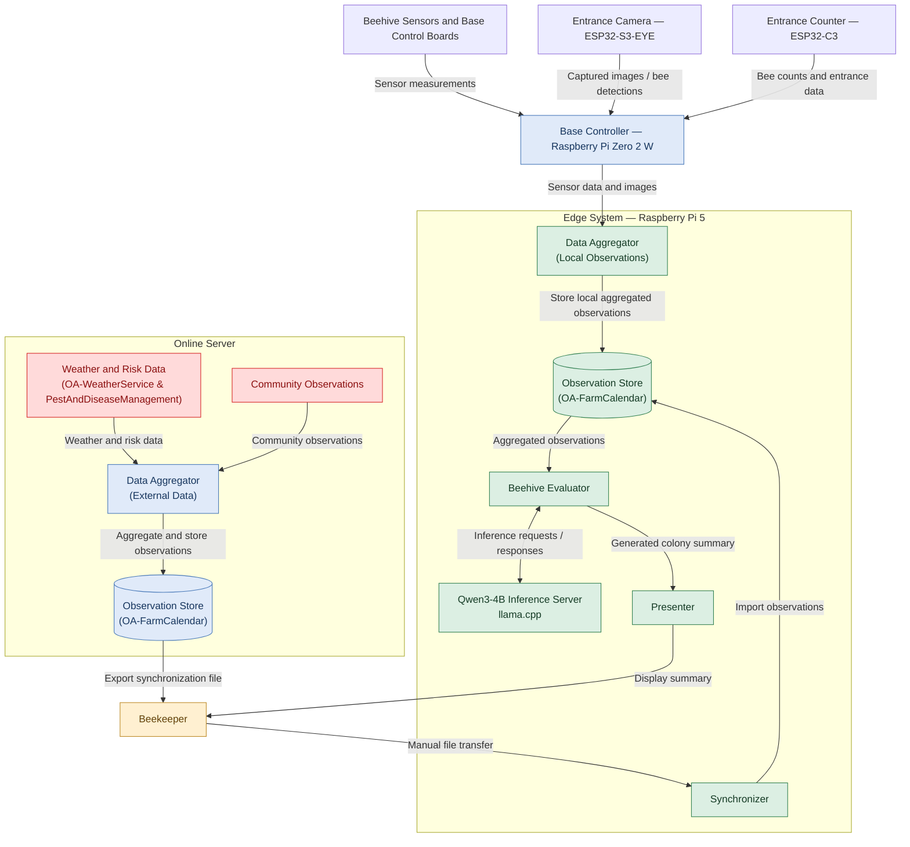
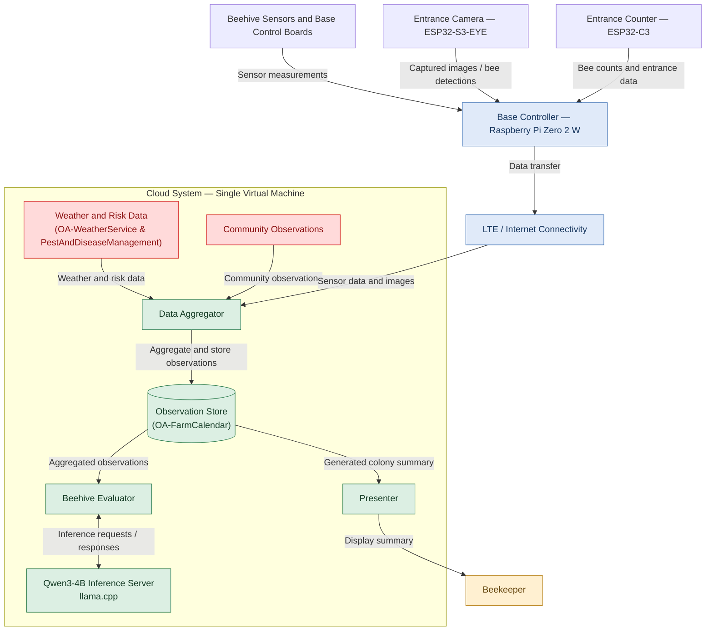

<table>
  <tr>
    <td width="120" align="center">
      
    </td>
    <td>
      <h1>Smart Community Integrated Beehive (SCIBee)</h1>
    </td>
  </tr>
</table>

SCIBee is an integrated beekeeping monitoring and management system combining beehive sensors, automated control hardware, entrance monitoring, camera-based bee detection, data aggregation, and AI-assisted colony assessment. It integrates local observations with agricultural and community data to support colony monitoring, seasonal assessment, and identification of potential risks, including Varroa mite infestations.

The system combines embedded controllers, Raspberry Pi computers, Python services, locally hosted AI models, and [OpenAgri](https://horizon-openagri.eu/) services. It supports two deployment modes: **Cloud Mode** and **Edge Mode**.

## System Overview

SCIBee consists of several interconnected subsystems:

- **Base Control System** — Measures beehive weight, treatment-agent mass, environmental conditions, and electrical parameters. It also supports automated treatment control.

- **Entrance Monitoring System** — Measures bee traffic, controls the entrance mechanism, and captures images for AI-assisted bee and Varroa monitoring.

- **Base Controller** — Uses a Raspberry Pi Zero 2 W to communicate with the base control boards over I²C, collect measurements, and provide a web interface for monitoring and control.

- **Observation Aggregator** — Processes sensor measurements and camera data, calculates statistics, performs image-based Varroa detection, and creates structured observations.

- **Beehive Evaluator** — Uses Qwen3-4B with `llama.cpp` to analyze aggregated observations and generate colony assessments and risk summaries.

- **OpenAgri Integration** — Connects SCIBee to Farm Calendar and related agricultural services for observations, weather data, and risk assessments.

- **Community Information System** — Collects community observations about flowering plants, meadow management, Varroa, and pesticide spraying.

- **Synchroniser** — Used for manual transfer of online observations to the Edge system.

- **Presenter** — Displays the latest AI-generated beehive evaluation retrieved from Farm Calendar.

The deployment mode determines where processing and AI inference run and whether external data integrations are directly available to the Aggregator.

## Deployment Modes

SCIBee supports two deployment modes that share the core beehive monitoring hardware and software but differ in processing infrastructure, connectivity, and data integration.

### Edge Mode

Edge Mode runs the main processing services and AI inference locally, close to the beehive powered exclusively by solar power.

- A Raspberry Pi Zero 2 W acts as the local base controller.
- A Raspberry Pi 5 hosts the Data Aggregator, Beehive Evaluator, Qwen3-4B inference server, and supporting services.
- The Raspberry Pi devices communicate over a local network.
- Sensor measurements and camera data are processed locally.
- Weather, risk, and community data integrations that require internet access are not available to the Aggregator.
- Observations from an online server can be transferred to the local Observation Store using a manually transferred synchronization file.

**Architecture:**

### Cloud Mode

In Cloud Mode beehive data is collected by a remotely hosted processing environment.

- A Raspberry Pi Zero 2 W acts as the local base controller.
- A SIM7600G-H cellular modem provides LTE connectivity.
- A single cloud virtual machine hosts the Data Aggregator, Observation Store, Beehive Evaluator, and Qwen3-4B inference server.
- The Aggregator can integrate beehive data, external weather forecasts, risk assessments, and community observations.
- Tailscale provides private network connectivity for remote administration and access to connected devices and services.

**Architecture:**

### Cloud vs. Edge

| Aspect                      | Cloud Mode              | Edge Mode                                                   |
| --------------------------- | ----------------------- | ----------------------------------------------------------- |
| Base controller             | Raspberry Pi Zero 2 W   | Raspberry Pi Zero 2 W                                       |
| Processing infrastructure   | Remote virtual machine  | Local Raspberry Pi 5                                        |
| Controller connectivity     | LTE modem               | Local Wi-Fi network                                         |
| AI inference                | Cloud server            | Local Raspberry Pi 5                                        |
| Weather and risk evaluation | Supported               | Skipped when observations are missing                       |
| Synchronization             | Automatic data transfer | Manual synchronization file transfer from the online server |
| Internet requirement        | Required                | Not required (only for online data)                         |

**Key distinction:** Cloud Mode centralizes processing and supports online data integrations. Edge Mode runs processing and AI inference locally, reducing dependence on remote infrastructure for core monitoring and evaluation, but requires manual synchronization of online observations.

## Hardware and Embedded Systems

### Base Control System

The Base Control System monitors beehive weight, treatment-agent mass, environmental conditions, and electrical parameters. Dedicated control boards communicate with the Raspberry Pi Zero 2 W over I²C.

- [Base Control System — Architecture and Hardware](SCIBee_Base/scibee_base_control_system.md)
- [Base Control Board — Firmware and I²C Protocol](SCIBee_Base/scibee_base_control_board_firmware.md)
- [Base Controller — Python Backend and Web Interface](SCIBee_Base/scibee_base_controller.md)
- [Base Stand — Mechanical Design](SCIBee_Base/scibee_base_stand.md)

### Entrance Monitoring System

The Entrance Monitoring System combines bee-traffic measurement, entrance control, and camera-based image capture.

The ESP32-C3-based entrance counter collects measurements from the entrance corridor array and controls the entrance mechanism. A separate ESP32-S3-EYE camera module captures images for AI-assisted bee detection and subsequent analysis.

- [Entrance System — Architecture and Hardware](SCIBee_Entrance/scibee_entrance_system.md)
- [Entrance Counter Corridor — Mechanical and Electrical Design](SCIBee_Entrance/scibee_entrance_counter_corridor.md)
- [Entrance Counter Corridor — Firmware](SCIBee_Entrance/scibee_entrance_counter_corridor_firmware.md)
- [Entrance Counter — Firmware](SCIBee_Entrance/scibee_entrance_counter_firmware.md)
- [Entrance Camera — Firmware and AI Detection](SCIBee_Entrance/scibee_entrance_camera_firmware.md)
- [Entrance and Camera — Firmware Programming Guide](SCIBee_Entrance/scibee_entrance_firmware_programming.md)

## Software Services and Data Processing

### Data Aggregator

The Data Aggregator collects beehive sensor measurements and camera data, calculates statistics, performs image-based Varroa detection, and creates structured observations in Farm Calendar.

Its execution mode determines whether external weather forecasts, risk assessments, and community observations are included.

See [SCIBee Aggregator](SCIBee_Data_Aggregator/scibee_aggregator.md).

### Beehive Evaluator

The Beehive Evaluator retrieves aggregated observations and submits them to a locally hosted Qwen3-4B language model through `llama.cpp`. It generates a structured assessment of colony conditions, seasonal development, and potential risks, then stores the result in Farm Calendar or the configured observation store.

See [SCIBee Evaluator](SCIBee_Evaluator/scibee_evaluator.md).

### OpenAgri Integration

The OpenAgri helper modules provide reusable Python functionality for interacting with agricultural services through REST APIs.

See [SCIBee Helper Functions for OpenAgri Services](SCIBee_OA_Functions/oa_functions.md).

### Community Information System

The Community Information System collects and shares local environmental information relevant to beekeeping, including flowering observations, meadow management, Varroa reports, and pesticide spraying.

See [SCIBee Community](SCIBee_Community/scibee_community.md).

### Synchroniser

The Synchroniser enables manual transfer of online observations to the local Edge Observation Store using a JSON file.

See [SCIBee Synchroniser](SCIBee_Synchroniser/scibee_synchroniser.md).

### Presenter

The Presenter retrieves the latest AI-generated beehive evaluation from Farm Calendar and displays the assessment details and evaluation age for a selected beehive.

See [SCIBee Presenter](SCIBee_Presenter/scibee_presenter.md).

## Getting Started

1. **Choose a deployment mode.** Use Cloud Mode for remote processing and online data integrations, or Edge Mode for local processing and AI inference.
2. **Configure the hardware.** Follow the relevant setup guide for the Raspberry Pi devices, networking, and required services.
3. **Deploy the Base Controller.** Configure I²C communication with the base control boards and verify local monitoring and control.
4. **Configure the software services.** Deploy the Aggregator and Evaluator, configure their service endpoints and execution mode, and set up the required OpenAgri services.
5. **Verify the data flow.** Confirm that sensor measurements and camera data are collected, observations are aggregated, and AI-generated evaluations are stored and available to the presentation layer.

**Note:** The system is **not yet plug-and-play**. Configuration must be reviewed and adapted to the specific hardware arrangement and network setup. Configuration examples may contain placeholder credentials, IP addresses, hostnames, and service URLs. Replace these with values appropriate for your deployment.

## Documentation Index

| Document                                                                                           | Description                                                                        |
| -------------------------------------------------------------------------------------------------- | ---------------------------------------------------------------------------------- |
| [Cloud Raspberry Pi Gateway Setup](SCIBee_Setup_Cloud/scibee_setup_cloud_rpi.md)                   | Gateway configuration, LTE connectivity, Tailscale, and Base Controller deployment |
| [Cloud Server Setup](SCIBee_Setup_Cloud/scibee_setup_cloud_server.md)                              | Virtual machine, Docker, AI inference, and service deployment                      |
| [Edge Raspberry Pi Setup](SCIBee_Setup_Edge/scibee_setup_edge_rpi.md)                              | Local networking, Raspberry Pi 5, AI inference, and service deployment             |
| [Observation Aggregator](SCIBee_Data_Aggregator/scibee_aggregator.md)                              | Data collection, processing modes, and observation integration                     |
| [Beehive Evaluator](SCIBee_Evaluator/scibee_evaluator.md)                                          | AI-based evaluation of aggregated beehive observations                             |
| [Base Controller](SCIBee_Base/scibee_base_controller.md)                                           | Python backend, web interface, measurement logging, and control                    |
| [Base Control System](SCIBee_Base/scibee_base_control_system.md)                                   | Hardware architecture and measurement components                                   |
| [Base Control Board Firmware](SCIBee_Base/scibee_base_control_board_firmware.md)                   | Embedded firmware and I²C command protocol                                         |
| [Base Stand](SCIBee_Base/scibee_base_stand.md)                                                     | Mechanical design and structural components                                        |
| [Entrance System](SCIBee_Entrance/scibee_entrance_system.md)                                       | Entrance monitoring hardware and architecture                                      |
| [Entrance Counter Corridor](SCIBee_Entrance/scibee_entrance_counter_corridor.md)                   | Corridor structure, electronics, and sensor arrangement                            |
| [Entrance Counter Corridor Firmware](SCIBee_Entrance/scibee_entrance_counter_corridor_firmware.md) | Corridor sensor firmware and I²C protocol                                          |
| [Entrance Counter Firmware](SCIBee_Entrance/scibee_entrance_counter_firmware.md)                   | Bee counting, entrance control, and data logging                                   |
| [Entrance Camera Firmware](SCIBee_Entrance/scibee_entrance_camera_firmware.md)                     | Camera operation, AI detection, image capture, and storage                         |
| [Firmware Programming Guide](SCIBee_Entrance/scibee_entrance_firmware_programming.md)              | Development environment, firmware uploads, and board configuration                 |
| [OpenAgri Helper Functions](SCIBee_OA_Functions/oa_functions.md)                                   | Python utilities for OpenAgri REST APIs                                            |
| [Community Information System](SCIBee_Community/scibee_community.md)                               | Community applications, architecture, and data handling                            |
| [Synchroniser](SCIBee_Synchroniser/scibee_synchroniser.md)                                         | Manual transfer of online observations to the Edge system                          |
| [Presenter](SCIBee_Presenter/scibee_presenter.md)                                                  | Displays the latest AI-generated beehive evaluation                                |

## Notes

- **Network configuration:** Use IP addresses, subnets, hostnames, and service URLs appropriate to your deployment.
- **Time synchronization:** Services and embedded devices use UTC timestamps. Ensure that clocks are synchronized and time settings are configured consistently across devices and services.
- **Treatment decisions:** Sensor measurements and AI-generated assessments are decision-support tools. Follow applicable product instructions and veterinary guidance when making treatment decisions.
