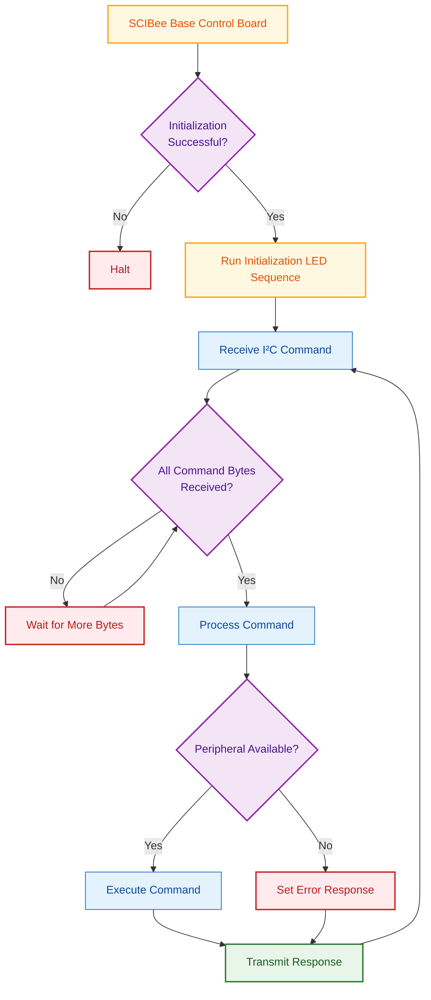

# SCIBee Base Control Board — Firmware

## Overview

This repository contains the Arduino firmware for the SCIBee Base Control Board, based on the RP2350 microcontroller. It communicates over I²C with a Raspberry Pi Zero 2 W, controls onboard actuators, and reads measurements from connected sensors.

## Main Functions

- **I²C communication:** Receives commands from the Raspberry Pi Zero 2 W and transmits three-byte responses.
- **LED control:** Controls the red, yellow, and green status LEDs.
- **Actuator control:** Controls two H-bridges and a piezo pump.
- **Load cell measurements:** Reads data from a NAU7802 load cell amplifier.
- **Environmental measurements:** Reads temperature, humidity, pressure, and altitude from a BME280 sensor.
- **Energy measurements:** Reads power, energy, bus voltage, current, shunt voltage, charge, and die temperature from an INA228 monitor.
- **Real-time clock:** Reads and sets the date and time using a PCF85063 RTC.
- **Error indication:** Returns `0xFF 0xFF 0xFF` for unknown commands and commands requiring unavailable peripherals. Certain initialization failures halt the firmware.

## Program Flowchart



## I²C Communication Protocol

The Raspberry Pi Zero 2 W acts as the I²C master, and the SCIBee Base Control Board acts as the I²C peripheral.

### Command format

Each command is expected to contain two bytes:

| Byte   | Description                    |
| ------ | ------------------------------ |
| Byte 0 | Command ID                     |
| Byte 1 | Command parameter, if required |

The receive handler reads `RXbytes` bytes, where `RXbytes` is defined by the SCIBee library. The supplied code assumes the expected number of bytes arrives; it does not handle short messages safely.

**Important:** If fewer than `RXbytes` bytes arrive, `I2C_RxHandler()` can wait indefinitely in its receive loop. There is no timeout or short-message recovery in the handler.

### Response format

The transmit handler sends `TXbytes` bytes from the transmit buffer. The code uses a three-byte buffer for measurement values and error responses.

| Byte   | Description            |
| ------ | ---------------------- |
| Byte 0 | Least significant byte |
| Byte 1 | Middle byte            |
| Byte 2 | Most significant byte  |

Numeric values packaged by `packageTo3Bytes()` use little-endian byte order. The Raspberry Pi can reconstruct the unsigned 24-bit representation as follows:

```python
value = Byte0 + (Byte1 << 8) + (Byte2 << 16)
```

RTC date and time commands return separate fields rather than one combined numeric measurement.

**Important:** Not every command writes a new response payload. Actuator commands and RTC-setting commands leave the transmit buffer unchanged. The returned bytes must not be treated as an acknowledgement.

## Command Reference

### 1. LEDs and Actuators

| Command ID | Command                | Parameter   | Response type | Description                                                                      |
| ----------:| ---------------------- | ----------- | ------------- | -------------------------------------------------------------------------------- |
| 1          | System reset           | —           | —             | The command handler is empty; no reset is performed.                             |
| 4          | Red LED ON             | —           | —             | Turns the red LED on.                                                            |
| 5          | Red LED OFF            | —           | —             | Turns the red LED off.                                                           |
| 6          | Yellow LED ON          | —           | —             | Turns the yellow LED on.                                                         |
| 7          | Yellow LED OFF         | —           | —             | Turns the yellow LED off.                                                        |
| 8          | Green LED ON           | —           | —             | Turns the green LED on.                                                          |
| 9          | Green LED OFF          | —           | —             | Turns the green LED off.                                                         |
| 10         | Release both H-bridges | —           | —             | Turns braking off for H-bridges A and B.                                         |
| 11         | H-bridge A brake ON    | —           | —             | Activates the brake for H-bridge A.                                              |
| 12         | H-bridge A forward     | Drive value | —             | Calls `Bridge_state()` for bridge A with the supplied parameter.                 |
| 13         | H-bridge A reverse     | Drive value | —             | Calls `Bridge_state()` for bridge A with the negative of the supplied parameter. |
| 14         | H-bridge B brake ON    | —           | —             | Activates the brake for H-bridge B.                                              |
| 15         | H-bridge B forward     | Drive value | —             | Calls `Bridge_state()` for bridge B with the supplied parameter.                 |
| 16         | H-bridge B reverse     | Drive value | —             | Calls `Bridge_state()` for bridge B with the negative of the supplied parameter. |
| 20         | Piezo pump STOP        | —           | —             | Sets the pump mode to `STOP`.                                                    |
| 21         | Piezo pump RUN         | —           | —             | Sets the pump mode to `RUN`.                                                     |

The firmware passes the drive value directly from the second command byte, or negates it for reverse commands. The supported drive range depends on the SCIBee library implementation.

### 2. Load Cell — NAU7802

| Command ID | Command                       | Parameter | Response type                 | Description                                                                                                                        |
| ----------:| ----------------------------- | --------- | ----------------------------- | ---------------------------------------------------------------------------------------------------------------------------------- |
| 30         | Load cell power OFF           | —         | —                             | Turns off load cell power.                                                                                                         |
| 31         | Load cell power ON, channel 1 | —         | —                             | Turns on load cell power, selects NAU7802 channel 1, and recalibrates the analogue front end. Requires `scale_F = true`.           |
| 32         | Load cell power ON, channel 2 | —         | —                             | Turns on load cell power, selects NAU7802 channel 2, and recalibrates the analogue front end. Requires `scale_F = true`.           |
| 33         | Read load cell                | —         | 24-bit integer representation | Accumulates available readings and packages the absolute value of the running average into three bytes. Requires `scale_F = true`. |

For commands 31 and 32, the firmware waits one second after enabling load cell power, changes the channel, waits another 100 ms, and calls `calibrateAFE()`.

For command 33, the firmware accumulates readings while `Scale.available()` is true. It updates the transmit buffer with `abs(currentReading) / i` as readings arrive. The I²C transmit handler sets `readCycle` to `false`, ending the reading loop.

The transmitted load-cell result therefore represents the absolute value of the average of the accumulated readings, not a signed measurement. The final number of samples depends on when the I²C master requests the response.

If the load cell is unavailable, commands 31–33 call the error handler. Command 30 does not check `scale_F`.

### 3. Real-Time Clock — PCF85063

| Command ID | Command             | Parameter   | Response type     | Description                                                                                        |
| ----------:| ------------------- | ----------- | ----------------- | -------------------------------------------------------------------------------------------------- |
| 40         | Read date           | —           | Three date fields | Returns year, month, and day of month in Bytes 0–2, respectively.                                  |
| 41         | Read time           | —           | Three time fields | Returns hour, minute, and second in Bytes 0–2, respectively.                                       |
| 44         | Set year field      | Year offset | —                 | Stores the year offset from 2000.                                                                  |
| 45         | Set month           | Month       | —                 | Stores the month value.                                                                            |
| 46         | Set day             | Day         | —                 | Stores the day of month.                                                                           |
| 47         | Set hour            | Hour        | —                 | Stores the hour value.                                                                             |
| 48         | Set minute          | Minute      | —                 | Stores the minute value.                                                                           |
| 49         | Apply date and time | —           | —                 | Stops the clock, writes the stored date and time with seconds set to zero, and restarts the clock. |

For command 44, the year is interpreted as an offset from 2000. For example, an offset of `26` represents 2026.

Commands 44–48 only store the individual date and time fields. Command 49 applies those fields to the RTC. The code does not explicitly validate the supplied field ranges.

The RTC availability flag, `rtc_F`, is set during initialization by checking whether the RTC's seconds field advances as expected. If the RTC is not detected, commands 40–49 call the error handler.

### 4. Environmental Sensor — BME280

| Command ID | Command          | Parameter | Response type   | Description                                                       |
| ----------:| ---------------- | --------- | --------------- | ----------------------------------------------------------------- |
| 50         | Read temperature | —         | Encoded integer | Returns `temperature in °C × 10 + 1280`.                          |
| 51         | Read humidity    | —         | Integer (%)     | Returns relative humidity converted to an integer percentage.     |
| 52         | Read pressure    | —         | Integer (Pa)    | Returns atmospheric pressure in pascals, converted to an integer. |
| 53         | Read altitude    | —         | Integer (m)     | Returns altitude in metres, converted to an integer.              |

To convert the temperature response to degrees Celsius:

```python
temperature_c = (value - 1280) / 10
```

The environmental sensor availability flag, `envS_F`, is set during initialization. Commands 50–53 call the error handler if the sensor was not detected.

### 5. Energy Monitor — INA228

| Command ID | Command              | Parameter | Response type           | Description                                                                                  |
| ----------:| -------------------- | --------- | ----------------------- | -------------------------------------------------------------------------------------------- |
| 60         | Read power           | —         | Integer (mW)            | Returns power in milliwatts.                                                                 |
| 61         | Read energy          | —         | Integer (J)             | Returns energy in joules.                                                                    |
| 62         | Read bus voltage     | —         | Integer (mV)            | Returns bus voltage in millivolts.                                                           |
| 63         | Read current         | —         | Integer (0.1 mA units)  | Returns current in milliamperes multiplied by 10; each integer unit represents 0.1 mA.       |
| 64         | Read shunt voltage   | —         | Integer (0.01 mV units) | Returns shunt voltage in millivolts multiplied by 100; each integer unit represents 0.01 mV. |
| 68         | Read charge          | —         | Integer (C)             | Returns charge in coulombs.                                                                  |
| 69         | Read die temperature | —         | Integer (°C)            | Returns die temperature in degrees Celsius.                                                  |

The firmware converts each reading to an integer before packaging it into the three-byte transmit buffer.

The INA228 availability flag, `enrgM_F`, is set during initialization. Commands 60–64 and 68–69 call the error handler if the monitor was not detected.

### 6. Error Handling and Status Indication

| Condition                            | Response         | Firmware behavior                                             |
| ------------------------------------ | ---------------- | ------------------------------------------------------------- |
| Required peripheral unavailable      | `0xFF 0xFF 0xFF` | Calls `noDevice_error()` and requests a red LED indication.   |
| Unknown command ID                   | `0xFF 0xFF 0xFF` | Calls `noDevice_error()` and requests a red LED indication.   |
| Scale not detected at startup        | —                | Sets `scale_F = false`; initialization continues.             |
| Scale detected but setup checks fail | —                | Red LED remains on while the firmware halts in an error loop. |
| SCIBee board initialization fails    | —                | Firmware halts without explicitly turning on the red LED.     |

The firmware also uses the LEDs to indicate normal operation:

- **Yellow LED:** Indicates I²C communication activity. The firmware also uses it during initialization.
- **Green LED:** Indicates command execution and is used in the initialization sequence.
- **Red LED:** Indicates certain errors and is used in the initialization sequence.

## Hardware

- **SCIBee Base Control Board:** RP2350-based microcontroller board.
- **Raspberry Pi Zero 2 W:** I²C master and host controller.
- **NAU7802:** Load cell amplifier.
- **BME280:** Temperature, humidity, pressure, and altitude sensor.
- **PCF85063:** Real-time clock.
- **INA228:** Power and energy monitor.
- **H-bridges A and B:** Motor or actuator control.
- **Piezo pump:** Part of the SCIBee Base Control Board.

## Notes

- **—** means no input parameter is required or no specific response payload is defined for the command.
- **Response type** describes the format of a newly prepared response, not an acknowledgement that the command succeeded.
- **Little-endian** means the least significant byte is transmitted first.
- **`0xFF 0xFF 0xFF`** is the error response used for unknown commands and commands requiring unavailable peripherals.
- **24-bit integer representation** describes the three-byte packed format. The firmware does not define a general signed 24-bit decoding convention; interpret each response according to the relevant command's conversion rules.
- **Availability flags** (`scale_F`, `rtc_F`, `envS_F`, `enrgM_F`) record peripheral detection during initialization; they are not continuous health checks.
