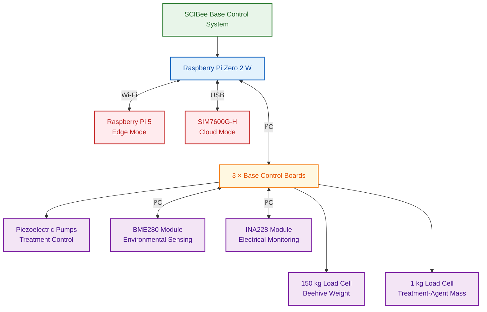

# SCIBee Base Control System

The SCIBee Control System monitors beehive weight and internal environmental conditions and supports automated Varroa mite treatment using formic acid.

## 1. System Overview

The system supports three beehives, each equipped with a dedicated Base Control Boards. The Base Control Boards communicate with a Raspberry Pi Zero 2 W over I²C. The Raspberry Pi provides local Wi-Fi connectivity and coordinates system operation.

Each hive uses a 150 kg load cell to measure beehive weight and a 1 kg load cell to measure treatment-agent mass. Separate BME280 and INA228 modules connect to each Base Control Board via I²C for environmental and electrical measurements.

## 2. System Components and Interfaces

| Component           | Model                     | Quantity              |
| ------------------- | ------------------------- | ---------------------:|
| Base Control Board  | Custom PCB                | 3                     |
| Base controller     | Raspberry Pi Zero 2 W     | 1                     |
| Edge computer       | Raspberry Pi 5            | 1, for edge mode      |
| 4G modem            | SIM7600G-H                | 1, for cloud mode     |
| Step-down converter | SY8205-based, 12 V to 5 V | 1                     |
| SD card             | Compatible SD card        | 1, (+1 for edge mode) |
| SIM card            | Compatible LTE SIM        | 1, for cloud mode     |

## 3. Base Control Board

### Components

| Component           | Model                       | Quantity per Base Control Board | Function                 |
| ------------------- | --------------------------- | -------------------------------:| ------------------------ |
| Microcontroller     | RP2350                      | 1                               | Beehive control          |
| Load-cell amplifier | NAU7802                     | 2                               | Load-cell measurement    |
| Real-time clock     | PCF85063                    | 1, optional                     | Timekeeping              |
| Piezoelectric pump  | Murata MZB3004T04           | 1                               | Treatment-agent delivery |
| Pump driver         | H-bridge / driver circuitry | 1 set                           | Pump control             |

### Specifications

| Parameter       | Specification   |
| --------------- | --------------- |
| Design software | KiCad           |
| PCB stack-up    | 4 layers        |
| Logic voltage   | 3.3 V           |
| PCB supply      | 12 V nominal    |
| Communication   | 2 × I²C buses   |
| Dimensions*     | 90 × 90 × 80 mm |

\* Dimensions refer to the assembled Base Control  Board, including pump hardware.

## 4. Measurement Components

| Component                  | Model / Capacity  | Quantity per hive | Interface                     | Function                                     |
| -------------------------- | ----------------- | -----------------:| ----------------------------- | -------------------------------------------- |
| Beehive load cell          | Zemic L6G, 150 kg | 1                 | Load-cell amplifier (NAU7802) | Measures beehive weight                      |
| Treatment-agent load cell  | 1 kg capacity     | 1                 | Load-cell amplifier (NAU7802) | Measures treatment-agent mass                |
| Environmental sensor board | BME280            | 1                 | I²C                           | Measures temperature, humidity, and pressure |
| Power monitor board        | INA228            | 1                 | I²C                           | Measures voltage, current, and power         |

The BME280 and INA228 are separate modules connected to each Base Control Board via I²C.

## 5. Calibration and Testing

| Test                       | Procedure                                                     |
| -------------------------- | ------------------------------------------------------------- |
| Beehive weight             | Calibrate the 150 kg load cell using known weights            |
| Treatment-agent mass       | Calibrate the 1 kg load cell using known reference masses     |
| Environmental measurements | Check BME280 readings against a suitable reference instrument |
| Electrical measurements    | Verify INA228 readings against suitable reference instruments |

## 6. Power Supply

The system is powered by a 12 V, 80 Ah lead-acid battery. A 5 V supply from a step-down converter powers the Raspberry Pi modules and the 4G modem. The Base Control Boards are powered by 12 V and contain the necessary onboard power converters.

## 7. Mechanical Design

Mechanical components are designed in OpenSCAD and FreeCAD and fabricated using FDM 3D printing. The electronics are installed inside an empty honeycomb frame within the SCIBee base.

| Parameter         | Specification           |
| ----------------- | ----------------------- |
| CAD software      | OpenSCAD, FreeCAD       |
| Printed materials | White and black PETG    |
| Fasteners         | M3 Steel bolts and nuts |
| Threaded inserts  | M3 Brass                |
| Mounting          | On the honeycomb frame  |
