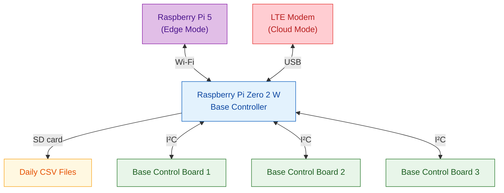
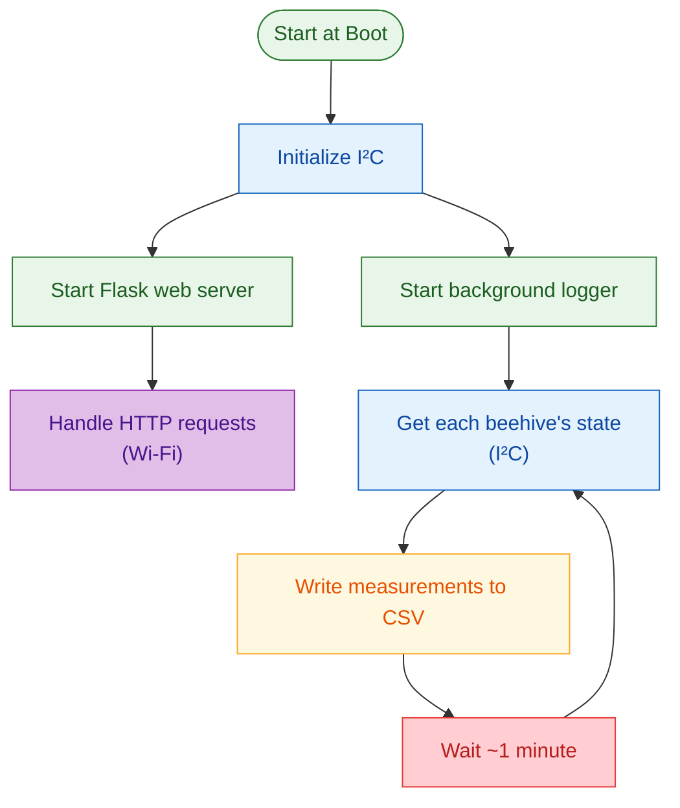

# SCIBee Base Controller — Python Backend and Web Interface

## Overview

This repository contains the SCIBee Base Controller application, running on a Raspberry Pi Zero 2 W. It provides a web interface for monitoring and controlling three SCIBee beehives through I²C communication with their Base Control Boards.

The application consists of a Python backend using Flask and a webpage built with HTML, CSS, and JavaScript.

## Main Functions

- **Sensor monitoring:** Reads load cell measurements, temperature, humidity, pressure, voltage, and current.
- **Pump control:** Starts or stops the piezo pump on the selected beehive.
- **Time synchronization:** Synchronizes the Raspberry Pi system clock with NTP or the RTC on one beehive.
- **Data logging:** Records measurements approximately once per minute in daily CSV files.
- **Data download:** Lists and downloads historical measurement files through the web interface.
- **Multi-beehive support:** Supports multiple beehives configured in the backend.

## System Architecture



**Communication modes:**

- **Edge mode:** The Raspberry Pi Zero 2 W communicates with the Raspberry Pi 5 over Wi-Fi.
- **Cloud mode:** The Raspberry Pi Zero 2 W connects through an LTE modem to the cloud infrastructure.
- **Local hardware:** All three Base Control Boards connect to the Raspberry Pi Zero 2 W over I²C bus 1.

## Program Execution Flow

The application initializes the controller and starts a background logger before running the Flask web server. The logger repeatedly collects measurements from each configured beehive and writes them to the corresponding daily CSV files, approximately once per minute. The web server handles browser requests independently.



## Configuration

The main configuration parameters are defined in `base_controller.py`.

| Parameter     | Default value                   | Description                                                         |
| ------------- | ------------------------------- | ------------------------------------------------------------------- |
| `CSV_DIR`     | `"data"`                        | Directory where measurement CSV files are stored.                   |
| `BEEHIVES`    | `["D1", "D2", "D3"]`            | List of configured beehive identifiers processed by the controller. |
| `I2C_ADDR`    | `D1: 101`, `D2: 102`, `D3: 103` | I²C address assigned to each beehive's Base Control Board.          |
| `rtc_beehive` | `"D1"`                          | Beehive whose RTC is used for time synchronization.                 |

Beehive identifiers can be adapted to the hardware implementation, following the convention of an **uppercase letter followed by a number**, such as `D1`, `D2`, or `D3`. When adding or changing identifiers, update `BEEHIVES` and `I2C_ADDR` accordingly, and ensure the web interface and connected hardware use the same identifiers.

The `CSV_DIR` path is relative to the application's working directory unless configured as an absolute path.

## Installation

### Requirements

- Raspberry Pi Zero 2 W
- Python 3
- Enabled I²C interface
- SCIBee Base Control Boards

### Install dependencies

```bash
python3 -m venv .venv
source .venv/bin/activate
pip install -r requirements.txt
```

The required Python packages are:

```text
Flask
smbus2
```

## Data Logging

Measurements from all configured beehives are recorded approximately once per minute.

CSV files are stored in the directory specified by `CSV_DIR`, with one file per beehive per day.

Example filenames:

```text
D1_BBC_2026_10_21.csv
D2_BBC_2026_10_21.csv
D3_BBC_2026_10_21.csv
```

Each file contains:

| Column            | Description           | Unit   |
| ----------------- | --------------------- | ------ |
| `Epoch_time_ms`   | Measurement timestamp | ms     |
| `Loadcell_ch1_kg` | Load cell channel 1   | kg     |
| `Loadcell_ch2_kg` | Load cell channel 2   | kg     |
| `Temperature_C`   | Temperature           | °C     |
| `Humidity_%`      | Relative humidity     | %      |
| `Pressure_Pa`     | Atmospheric pressure  | Pa     |
| `Pump`            | Pump state            | 0 or 1 |
| `Voltage_V`       | Bus voltage           | V      |
| `Current_A`       | Electrical current    | A      |

## Web Interface

The webpage provides the following functions:

- **Snapshot data:** Displays the latest sensor measurements and pump state.
- **Set Time:** Synchronizes the system clock and RTC.
- **Set Pump:** Starts or stops the selected beehive's pump.
- **Get File:** Lists and downloads historical CSV files.
- **Auto-refresh:** Updates the displayed measurements approximately every minute.

### Access the Web Interface

The Base Controller runs automatically as a systemd service when the Raspberry Pi Zero 2 W starts. For direct access open the following address in a browser, replacing the IP address with that of the Raspberry Pi Zero 2 W:

```
http://<raspberry-pi-ip>:8998/
```

Select a beehive using the `beehive` URL parameter:

- `http://<raspberry-pi-ip>:8998/?beehive=D1`

- `http://<raspberry-pi-ip>:8998/?beehive=D2`

- `http://<raspberry-pi-ip>:8998/?beehive=D3`

If no beehive is specified, `D1` is selected by default.

## HTTP API

The Flask backend provides the following endpoints:

| Endpoint       | Function                         |
| -------------- | -------------------------------- |
| `/getTime`     | Read system time                 |
| `/setTime`     | Synchronize system time and RTC  |
| `/getSnapshot` | Retrieve the latest measurements |
| `/setPump`     | Control the pump                 |
| `/getFileList` | List available CSV files         |
| `/getFile`     | Download a CSV file              |

Requests for a specific beehive accept the `beehive` parameter. The `/setTime` endpoint supports only the beehive configured by `rtc_beehive`.

## Notes

- Load cell conversion coefficients are defined in the Python backend and must be calibrated for the installed hardware.
- The application requires appropriate permissions for I²C communication and system time adjustment.
