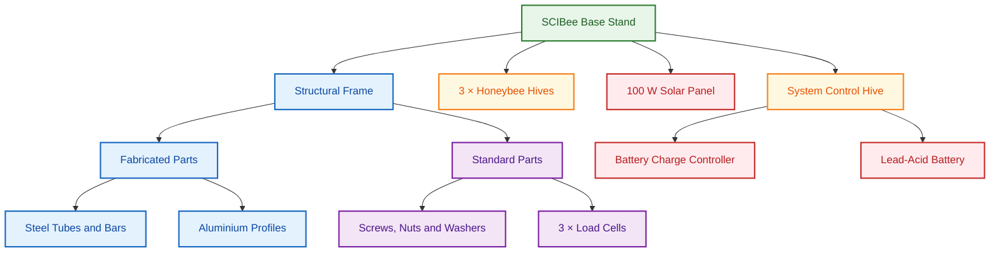

# SCIBee Base Stand

This document lists the structural and fabricated parts, fasteners, and purchased components required for the SCIBee Base Stand. The system accommodates three beehives housing honeybee colonies and one additional beehive used to house the control system.

## 1. System Overview

The SCIBee Base Stand consists of a structural frame, three honeybee hives, a separate control-system hive, and a solar power system. The diagram below illustrates the main system components.

## 2. Structural and Fabricated Parts

| Part No. | Description                                       | Quantity |
| --------:| ------------------------------------------------- | --------:|
| 1        | Square tube, 60 × 60 × 3 mm, L = 1200 mm          | 2        |
| 2        | Rectangular tube, 40 × 20 × 3 mm, L = 1400 mm     | 2        |
| 3        | Rectangular tube, 80 × 60 × 3 mm, L = 1064 mm     | 1        |
| 4        | Flat bar, 60 × 8 mm, L = 140 mm                   | 4        |
| 5        | Rectangular tube, 80 × 60 × 3 mm, L = 1064 mm     | 1        |
| 6        | Square tube, 60 × 60 × 3 mm, L = 440 mm           | 2        |
| 7        | End cap with holes, 120 mm, M12 thread            | 4        |
| 8        | Flat bar, 60 × 8 mm, L = 80 mm                    | 3        |
| 9        | Square tube, 60 × 60 × 3 mm, L = 440 mm           | 2        |
| 10       | Rectangular tube, 80 × 20 × 2 mm, L = 500 mm      | 8        |
| 11       | Rectangular tube, 60 × 20 × 3 mm, L = 500 mm      | 4        |
| 12       | Flat bar, 20 × 5 mm, L = 610 mm                   | 2        |
| 13       | Aluminium square profile, 30 × 30 mm, L = 1110 mm | 2        |

## 3. Fasteners, Nuts, and Washers

| Description     | Quantity |
| --------------- | --------:|
| M8 × 80 screws  | 28       |
| M8 × 90 screws  | 8        |
| M8 × 35 screws  | 12       |
| M12 × 80 screws | 16       |
| M8 × 20 screws  | 2        |
| M8 × 60 screws  | 2        |
| M8 nuts         | 28       |
| M12 nuts        | 16       |
| M8 washers      | 76       |

## 4. Purchased Components

| Component                    | Description                                                                       | Quantity |
| ---------------------------- | --------------------------------------------------------------------------------- | --------:|
| Zemic L6G load cell          | Load cell, 150 kg capacity                                                        | 3        |
| LR 1/1 beehive               | Honeybee colony hive: floor (bottom board), 3 supers, 30 frames, feeder, and roof | 3        |
| LR 1/1 beehive               | Control-system hive: floor (bottom board), 2 supers, 1 frame, and roof            | 1        |
| Monocrystalline solar module | 100 W, 1020 × 540 × 35 mm                                                         | 1        |
| Solar charge controller      | LS1012EU, 12 V, 10 A                                                              | 1        |
| MC4 connectors               | 200MC4 connector pair                                                             | 1 pair   |
| Cyclic battery               | SIGA S80, 80 Ah                                                                   | 1        |
