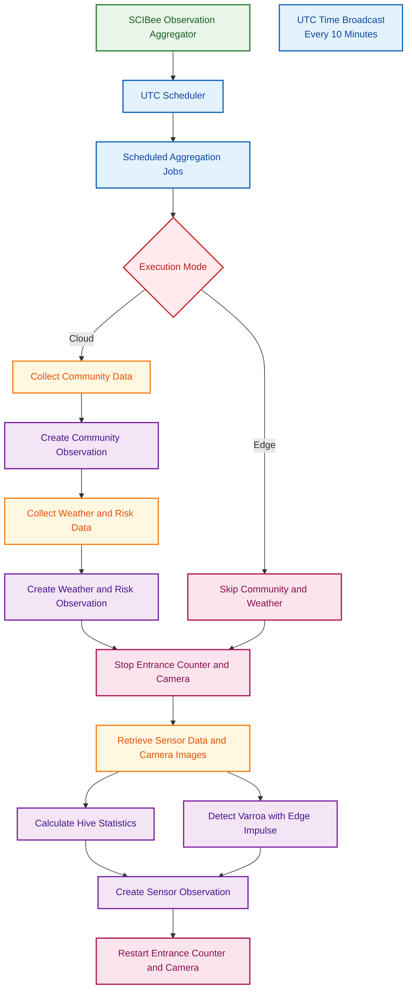

# SCIBee Cloud & Edge Observation Aggregator

## Overview

The SCIBee Observation Aggregator is a Python-based service that collects, processes, and stores beehive sensor data and, in cloud mode, weather forecasts, risk assessments, and community observations in Farm Calendar.

The service uses a UTC-based scheduler to coordinate aggregation tasks, communicates with beehive devices, performs image-based Varroa mite detection using an Edge Impulse model, and submits structured observations through the Gatekeeper and Farm Calendar APIs.

## Features

- **Bees and hive sensors:** Collects daily sensor data, including hive mass, temperature, humidity, and entrance-counter readings.
- **Varroa detection:** Processes camera image archives using the Edge Impulse `varroa_FOMO.eim` model.
- **Weather and risk assessment:** Retrieves weather forecasts and associated honey bee risk-model outputs in cloud mode.
- **Community observations:** Aggregates blooming, meadow/mowing, Varroa, and pesticide-spraying information in cloud mode.
- **Farm Calendar integration:** Creates structured observations associated with the relevant parcel and activity type.
- **Device lifecycle management:** Stops entrance-counter and camera systems before sensor-data collection and attempts to restart them afterward.
- **Time synchronization:** Periodically broadcasts the current UTC time to configured beehive devices.
- **Scheduled execution:** Uses APScheduler and multiprocessing to run aggregation jobs.
- **Logging:** Records execution details and errors in a rotating log file.

## Architecture

## Execution Modes

| Feature                          | Cloud mode                               | Edge mode        |
| -------------------------------- | ---------------------------------------- | ---------------- |
| Beehive sensor aggregation       | Enabled                                  | Enabled          |
| Camera-based Varroa detection    | Enabled                                  | Enabled          |
| Weather forecast integration     | Enabled                                  | Skipped          |
| Honey bee risk-model integration | Enabled                                  | Skipped          |
| Community data aggregation       | Enabled                                  | Skipped          |
| Gatekeeper authentication        | Enabled                                  | Enabled          |
| Farm Calendar observations       | Sensor, weather/risk, and community data | Sensor data only |
| Device time synchronization      | Enabled                                  | Enabled          |

Edge mode skips weather/risk and community integrations because they require internet access. Gatekeeper authentication and Farm Calendar API calls can use locally deployed services when their URLs are configured accordingly. Edge mode therefore still requires connectivity to the relevant local services and beehive devices.

The execution mode is controlled by the `EDGE_MODE` constant in the source code.

## Configuration

Create a `.env` file containing the required service configuration:

| Variable                 | Description                                  |
| ------------------------ | -------------------------------------------- |
| `ADMIN_USERNAME`         | Username used for Gatekeeper authentication. |
| `ADMIN_PASSWORD`         | Password used for Gatekeeper authentication. |
| `GATEKEEPER_BASE_URL`    | Base URL of the Gatekeeper service.          |
| `WEATHER_BASE_URL`       | Base URL of the weather forecast service.    |
| `FARM_CALENDAR_BASE_URL` | Base URL of the Farm Calendar API.           |
| `RISK_BASE_URL`          | Base URL of the risk-model service.          |

The application also requires `beehive_endpoints.json` to configure beehive device endpoints. In cloud mode, `community_endpoints.json` is additionally loaded for community data sources.

Keep credentials out of version control.

## Sensor Data Collection

For each configured beehive, the aggregator retrieves daily CSV data from the sensor endpoints and processes camera images from the corresponding daily TAR archive.

The collection process includes:

1. Stopping the entrance-counter and camera systems.
2. Retrieving daily sensor CSV files.
3. Calculating hive and environmental statistics.
4. Retrieving the camera image archive.
5. Running image-based Varroa detection.
6. Preparing a structured sensor observation.
7. Submitting the observation to Farm Calendar.
8. Attempting to restart the entrance-counter and camera systems.

Sensor data is retrieved for the previous UTC day. The camera archive follows the filename pattern `{beehive_name}_VVD_YYYY_MM_DD.tar`.

### Stored Sensor Observation Fields

| Field                   | Description                                                                      |
| ----------------------- | -------------------------------------------------------------------------------- |
| `hive_mass`             | Measured beehive mass.                                                           |
| `temperature`           | Recorded beehive temperature.                                                    |
| `humidity_min`          | Minimum recorded humidity.                                                       |
| `humidity_avg`          | Average recorded humidity.                                                       |
| `humidity_max`          | Maximum recorded humidity.                                                       |
| `incoming_bees`         | Last cumulative incoming-bee counter value from the daily entrance-counter data. |
| `outgoing_bees`         | Last cumulative outgoing-bee counter value from the daily entrance-counter data. |
| `inspected_images`      | Total number of camera images inspected for Varroa detection.                    |
| `images_with_varroa`    | Number of inspected images containing at least one detected Varroa mite.         |
| `detected_varroa_ratio` | Percentage of inspected images in which Varroa mites were detected.              |

The Edge Impulse model `varroa_FOMO.eim` filters detections using a confidence threshold of `0.5` and counts detections labelled `varroa`. Individual confidence scores, total mite detections, and average mites per image are not included in the current stored sensor payload.

## Weather and Risk Aggregation

In cloud mode, the service retrieves weather forecast data and evaluates honey bee-related risk models.

The aggregation includes:

- Weather forecast information.
- `Good Beekeeping Weather` assessment.
- `Formic Acid Treatment Weather` assessment.
- Honey Bee Hive Cycle.
- Honey Bee Bloom Availability.
- Honey Bee Bloom Trigger.
- Honey Bee Activity.
- Honey Bee Heat Stress.
- Honey Bee Varroa Brood Pressure.

The resulting data is submitted to Farm Calendar as a weather observation.

## Community Data Aggregation

In cloud mode, the service retrieves community data covering the previous 14 days from configured sources.

| Data category    | Description                                                      |
| ---------------- | ---------------------------------------------------------------- |
| Blooming (`BCI`) | Community blooming observations used to estimate blooming areas. |
| Meadows (`MCI`)  | Meadow and mowing observations used to estimate relevant areas.  |
| Varroa (`VCI`)   | Varroa-related reports, with quantities grouped by type.         |
| Spraying (`SCI`) | Pesticide-spraying events scheduled 1–7 days ahead.              |

Community estimates use a 3 km radius. Spatial estimates are weighted according to the applicable aggregation logic. Pesticide-spraying estimates additionally consider area, confidence, and harmfulness.

The resulting data is submitted to Farm Calendar as a community observation.

## Farm Calendar Observation Structure

Each aggregation creates a Farm Calendar observation with metadata identifying the observation, its associated parcel, and its type.

### Observation Metadata

| Field or property  | Description                                                               |
| ------------------ | ------------------------------------------------------------------------- |
| `title`            | Observation title containing a hash used to identify the aggregated data. |
| `phenomenonTime`   | Time associated with the observation.                                     |
| `observedProperty` | Observation category: `beehive`, `weather`, or `community`.               |
| Parcel association | Identifies the parcel associated with the observation.                    |
| Activity type      | Identifies the aggregation process.                                       |
| JSON details       | Structured payload containing the collected or calculated data.           |

### Observation Types

| Observation           | Activity type                     | `observedProperty` |
| --------------------- | --------------------------------- | ------------------ |
| Sensor data           | `Hive sensor data aggregation`    | `beehive`          |
| Weather and risk data | `Hive weather data aggregation`   | `weather`          |
| Community data        | `Hive community data aggregation` | `community`        |

The weather and community observations are created only in cloud mode.

## Scheduler and Time Synchronization

The service uses APScheduler with the UTC timezone.

- Aggregation jobs are configured to run at specific hours.
- The scheduled tasks run through a multiprocessing pool with three processes.
- 
- Device time synchronization runs every 10 minutes.
- The current UTC timestamp is broadcast to unique configured device endpoints through their `/setTime` endpoint.

The scheduler logs task execution results and exceptions.

## Logging

Application logs are written to `scheduler.log` using a rotating file handler.

- Maximum log file size: 5 MB.
- Backup files retained: 5.
- Log timestamps use UTC.

## Requirements and Operational Notes

- Python and the packages imported by the application must be installed.
- Required configuration files and environment variables must be available.
- Beehive devices and the configured APIs must be reachable.
- Edge mode requires access to the locally configured Gatekeeper and Farm Calendar services, as well as the sensor endpoints.
- The Edge Impulse model must be available at the configured model path.
- Device stop/start operations are attempted independently for the entrance counter and camera. Failures are logged.
