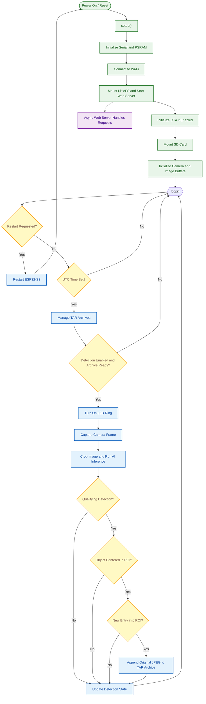

# SCIBee Camera and AI Module — Firmware

## Overview

The camera module firmware runs on an ESP32-S3-EYE and uses an Edge Impulse model to detect bees in the camera image. When a detected object enters the central observation region, the firmware saves the original JPEG image to a TAR archive on the SD card.

The firmware provides a web interface via Wi-Fi for time configuration, detection control, system status, image snapshots, and archive downloads. It maintains a software clock using UTC time set through the web interface.

## System Architecture

The firmware consists of the following subsystems:

- **Camera:** Captures 640 × 480 JPEG images using the ESP32-S3-EYE camera.

- **AI inference:** Runs an Edge Impulse model on a central image crop to detect objects.

- **Detection trigger:** Saves an image when a qualifying detection enters the defined central region.

- **LED illumination:** Controls the LED ring using PWM on GPIO 48.

- **Web server:** Provides browser-accessible controls, system status, time configuration, snapshots, and TAR archive access.

- **Time management:** Maintains a software clock based on UTC time set through the web interface.

- **Data storage:** Saves timestamped JPEG images in daily TAR archives on the SD card.

## Program Flowchart

The flowchart shows the initialization sequence in `setup()` and the repeated execution of `loop()`. The asynchronous web server handles HTTP requests independently of the main loop.



### Main Execution Sequence

1. **Initialization:** `setup()` initializes Serial, checks PSRAM, connects to Wi-Fi, mounts LittleFS, starts the web server, mounts the SD card, initializes the camera, and allocates image buffers.

2. **Time check:** The main loop waits until UTC time has been configured through the web interface.

3. **Archive management:** The firmware manages daily TAR archives and removes the oldest files when the configured archive limit is exceeded.

4. **Image capture:** When detection is enabled and an archive is available, the firmware captures camera frames and runs AI inference.

5. **Detection:** The firmware evaluates bounding-box confidence and checks whether the selected object's center is within the central observation region.

6. **Image logging:** A qualifying entry into the region triggers saving the original JPEG image to the current TAR archive.

7. **Web requests:** The asynchronous web server handles time configuration, detection control, snapshots, status queries, and archive downloads.

## Hardware Interfaces

| Interface           | Configuration          |
| ------------------- | ---------------------- |
| Controller          | ESP32-S3-EYE           |
| Camera resolution   | 640 × 480 pixels (VGA) |
| Camera image format | JPEG                   |
| Camera XCLK         | 10 MHz                 |
| LED ring            | GPIO 48                |
| LED PWM frequency   | 5 kHz                  |
| LED PWM resolution  | 10-bit                 |
| SD card interface   | SD_MMC, 1-bit mode     |
| SD card CLK         | GPIO 39                |
| SD card CMD         | GPIO 38                |
| SD card D0          | GPIO 40                |
| HTTP server         | Port 80                |
| OTA                 | Disabled by default    |

The LED ring is turned on during inference and manual snapshot capture. Its configured PWM duty value is `150` on a 10-bit scale.

## AI Detection

The firmware uses the Edge Impulse inference library included through `varroa_inferencing.h`. Compilation requires the model to be configured for camera input.

The processing pipeline is:

1. Capture a JPEG frame at 640 × 480 resolution.

2. Decode the image to RGB888.

3. Crop a centered 270 × 270 pixel region.

4. Resize the crop if required by the model input dimensions.

5. Run the Edge Impulse classifier.

6. Select the highest-confidence bounding box above the configured threshold.

7. Check whether the object's center is inside the observation region.

8. Save the original JPEG image when a new entry into the region is detected.

The confidence threshold is `0.5`. The accepted object-center position is defined relative to the center of the original image at `(320, 240)`, with a horizontal tolerance of ±80 pixels and a vertical tolerance of ±90 pixels.

The firmware uses an entry-trigger mechanism: remaining inside the region does not produce repeated images. The object must leave the region and enter again to trigger another save.

## Web Interface

The asynchronous HTTP server runs on port `80`. Static web interface files are served from LittleFS under `/www/`, with `index.html` as the default page.

The interface provides controls for:

- Setting the UTC date and time.

- Starting and stopping detection.

- Restarting the module.

- Viewing the current system state and time.

- Capturing a manual JPEG snapshot.

- Listing and downloading TAR archives.

### API Endpoints

All listed API endpoints use HTTP GET requests.

| Endpoint       | Request parameters                                 | Description                                  |
| -------------- | -------------------------------------------------- | -------------------------------------------- |
| `/setTime`     | `year`, `month`, `day`, `hour`, `minute`, `second` | Set the software clock in UTC.               |
| `/getTime`     | None                                               | Return the configured date and time.         |
| `/getState`    | None                                               | Return the current module state.             |
| `/start`       | None                                               | Enable detection.                            |
| `/stop`        | None                                               | Disable detection and turn off the LED ring. |
| `/reset`       | None                                               | Restart the module.                          |
| `/getSnapshot` | None                                               | Capture and return a JPEG image.             |
| `/getFileList` | None                                               | Return available TAR archive filenames.      |
| `/getFile`     | `file_name`                                        | Download a specified TAR archive.            |

The root endpoint `/` serves the web interface.

### Controller States

The `/getState` endpoint reports one of the following states:

- `waiting for time` — the software clock has not been configured.

- `running` — detection is enabled.

- `stopped` — detection is disabled.

Detection requires a configured time and an available current TAR archive.

### Image Snapshot

The `/getSnapshot` endpoint captures and returns a JPEG image without adding it to a TAR archive.

Snapshots are available only when detection is stopped. During capture, the LED ring is switched on, the firmware waits briefly for illumination, and then the camera takes an image.

### TAR Archive Access

The `/getFileList` endpoint returns the filenames of available `.tar` archives in the SD card root directory. It is available only when detection is stopped and the system time has been configured.

The `/getFile` endpoint requires the `file_name` parameter. The firmware accepts `.tar` filenames and rejects path traversal patterns such as `..` and `/`. A missing archive returns HTTP 404.

Archive downloads are available only when detection is stopped.

## Time Configuration

The module uses **UTC (Coordinated Universal Time)**. The software clock is set through `/setTime` and maintained using elapsed milliseconds. Automatic NTP synchronization is not implemented.

The `/setTime` endpoint requires the following query parameters:

- `year`

- `month`

- `day`

- `hour`

- `minute`

- `second`

The `/getTime` endpoint returns the date, time, and millisecond fields.

**Configure UTC time after every startup or power loss before starting detection or accessing the archive list.**

## Network Configuration

Configure the following values in the firmware before compiling and uploading:

```cpp
#define BEEHIVE_SSID "YOUR_WIFI_SSID"
#define BEEHIVE_ID "D1"
#define BEEHIVE_IP 111
#define BEEHIVE_SUBNET 4
#define OTA_ENABLE 0
```

The example configuration corresponds to the following network settings:

| Setting          | Value           |
| ---------------- | --------------- |
| Module ID        | `D1`            |
| IP address       | `192.168.4.111` |
| Gateway          | `192.168.4.1`   |
| Subnet mask      | `255.255.255.0` |
| HTTP server port | `80`            |

Set the Wi-Fi credentials in the firmware. Assign a unique IP address and module ID as required by the installation.

Wi-Fi connection is blocking during startup. The firmware checks for reconnection approximately every 60 seconds. OTA updates are disabled by default (`OTA_ENABLE 0`); when enabled, the OTA hostname is the module ID and the port is `3232`.

## Data Storage

Images are stored in daily TAR archives on the SD card.

Archive filenames use the format:

`{BEEHIVE_ID}_VVD_YYYY_MM_DD.tar`

Example:

`D1_VVD_2026_10_12.tar`

Image filenames use the format:

`{BEEHIVE_ID}_VVD_YYYY_MM_DDTHH_MM_SS_mmmZ.jpg`

Each new archive includes an `info.txt` file containing its creation timestamp. Captured images are appended to the current TAR archive as JPEG files.

The configured maximum number of TAR files is `56`. When this limit is exceeded, the firmware deletes the oldest archives.

### Archive Rollover

The firmware performs archive rollover at the UTC hour transition from `22` to `23`, rather than at UTC midnight. This aligns with midnight in UTC+1 standard time, but not UTC+2 daylight saving time.

## Startup and Operation

1. Configure the Wi-Fi credentials, module ID, and network address.

2. Compile and upload the firmware to the ESP32-S3-EYE.

3. Power on the module and allow Wi-Fi, LittleFS, the web server, SD card, and camera to initialize.

4. Open the web interface using the configured IP address.

5. Set the current UTC date and time.

6. Use **Start** to enable detection and image logging.

7. Use the interface to monitor the module state and control detection.

8. Use **Stop** before capturing a manual snapshot or accessing TAR archives.

9. Use the archive list to download stored image archives.
