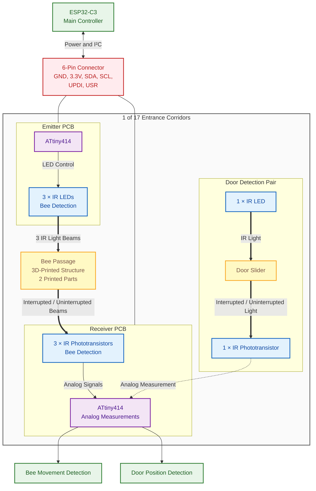

# SCIBee Entrance Counter Corridor

## Overview

The SCIBee Entrance Counter Corridor PCB uses an **ATtiny414-SS microcontroller**, powered by **3.3 V** and controlled by the main ESP32-C3 microcontroller via the **I²C bus**.

The corridor sensing system uses two PCBs connected through a **6-pin connector** carrying power, I²C signals, and the UPDI programming connection. Three IR LED–phototransistor pairs detect bee movement, while an additional IR LED–phototransistor pair detects the position of the door slider.

The receiver-side ATtiny414 reads the phototransistor signals using its analog inputs. Interruptions of the IR beams indicate bee movement or changes in the door slider position.

## Corridor Structure

Each corridor consists of **two 3D-printed structural parts** that form a passage through which bees can enter and exit. Three IR light beams cross the passage between the emitter and receiver PCBs. Bees interrupt these beams as they move through the corridor.

The door-position detection channel uses a separate IR LED–phototransistor pair on the same PCB. The door slider sits in the optical path between the LED and phototransistor. Its position can therefore be detected by measuring whether IR light reaches the phototransistor.

The complete entrance array consists of **18 corridor PCBs and 17 3D-printed corridor structures**, forming **17 individual corridors**.

## System Diagram

## Connector Pinout

The PCB uses a **6-pin vertical socket with 2.54 mm pitch** for power, I²C communication, and ATtiny414 programming.

| Pin | Signal | Description                                                  |
| ---:| ------ | ------------------------------------------------------------ |
| 1   | GND    | Ground; pin closest to the ATtiny414 microcontroller         |
| 2   | 3.3V   | Power supply                                                 |
| 3   | SDA    | I²C data                                                     |
| 4   | SCL    | I²C clock                                                    |
| 5   | UPDI   | ATtiny414 programming interface                              |
| 6   | USR    | Connected to the ATtiny414 microcontroller; currently unused |

**Connector orientation:** The GND pin is closest to the ATtiny414 microcontroller. Verify the physical pin numbering against the PCB layout or schematic before connecting the board.

## Bill of Materials (BOM)

| No. | Reference           | Description            | Value / Part Number | Package / Footprint          | Qty |
| ---:| ------------------- | ---------------------- | ------------------- | ---------------------------- | ---:|
| 1   | C1                  | Capacitor              | 1 µF                | 1206                         | 1   |
| 2   | R2, R4, R6, R9, R11 | Resistor               | 10 kΩ               | 1206                         | 5   |
| 3   | R1, R3, R5, R10     | Resistor               | 240 Ω               | 1206                         | 4   |
| 4   | R7, R8              | Resistor               | 2.2 kΩ              | 1206                         | 2   |
| 5   | D1–D4               | IR LED                 | IN-S126BTHIR        | 1206                         | 4   |
| 6   | U1                  | Microcontroller        | ATtiny414           | SOIC-14, 1.27 mm pitch       | 1   |
| 7   | Q1–Q4               | IR phototransistor     | IN-S126BTNPT        | 1206                         | 4   |
| 8   | J1                  | 6-pin connector socket | COM_BUS             | 1×6, vertical, 2.54 mm pitch | 1   |

### Component Summary

- **Total components per PCB:** 22
- **Unique BOM line items:** 8
- **Microcontroller:** ATtiny414
- **Operating voltage:** 3.3 V
- **Communication interface:** I²C
- **Programming interface:** UPDI
- **Optical components per PCB:** 4 IR LEDs and 4 IR phototransistors

## Entrance Array

The complete entrance array contains:

- **18 corridor PCBs**
- **17 individual corridors**
- **17 3D-printed corridor structures**, each consisting of two printed parts
- **3 IR LED–phototransistor pairs per corridor** for bee movement detection
- **1 additional IR LED–phototransistor pair per corridor** for door slider position detection

Together, these components provide optical bee-movement sensing and door-position detection across the entrance array.
