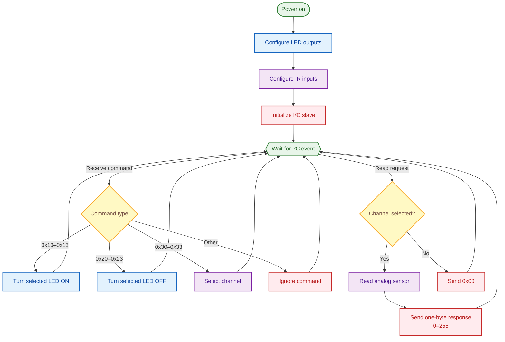

# SCIBee Entrance Counter Corridor — Firmware

## Overview

Each corridor PCB uses an **ATtiny414** as an I²C slave controlled by the main ESP32-C3. The ATtiny414 controls four IR LEDs and reads four phototransistor channels. Bee counting and door position detection are handled by the ESP32-C3.

## Program Flowchart



## Hardware Configuration

| Parameter            | Configuration      |
| -------------------- | ------------------ |
| MCU                  | ATtiny414          |
| Supply voltage       | 3.3 V              |
| Communication        | I²C slave          |
| LED outputs          | PA1, PA2, PB2, PB3 |
| Analog sensor inputs | PA4, PA5, PA6, PA7 |

Each LED is paired with the corresponding phototransistor: **D1–Q1, D2–Q2, D3–Q3, and D4–Q4**.

## I²C Addresses

Each PCB must have a unique I²C address configured before uploading the firmware.

Addresses follow a sequence from **40 (0x28)** to **57 (0x39)** across the 18 PCBs. PCB 1, closest to the ESP32-C3, uses address 40; PCB 18, farthest away, uses address 57.

Configure the address in the source code:

```cpp
const int I2C_ADDRESS = 40;
```

Change this value for each PCB before compiling and uploading.

## I²C Command Reference

The ESP32-C3 sends a single-byte command to control an LED or select a sensor channel.

### LED control commands

| Command (hex) | Decimal | Action          |
| ------------- | -------:| --------------- |
| `0x10`        | 16      | Turn LED D1 ON  |
| `0x11`        | 17      | Turn LED D2 ON  |
| `0x12`        | 18      | Turn LED D3 ON  |
| `0x13`        | 19      | Turn LED D4 ON  |
| `0x20`        | 32      | Turn LED D1 OFF |
| `0x21`        | 33      | Turn LED D2 OFF |
| `0x22`        | 34      | Turn LED D3 OFF |
| `0x23`        | 35      | Turn LED D4 OFF |

### IR sensor selection commands

| Command (hex) | Decimal | Selected input |
| ------------- | -------:| -------------- |
| `0x30`        | 48      | Q1 — PA4       |
| `0x31`        | 49      | Q2 — PA5       |
| `0x32`        | 50      | Q3 — PA6       |
| `0x33`        | 51      | Q4 — PA7       |

These commands select the sensor channel but do not return a measurement immediately. After sending a selection command, the ESP32-C3 requests one byte from the slave.

## Sensor Response

The ATtiny414 reads the selected phototransistor and returns an **8-bit value from 0 to 255**, converted from the 10-bit ADC reading.

- `0` — minimum reading; also returned if no channel is selected.
- `1–255` — increasing ADC readings.

The value represents the sensor's analog signal, not a direct bee count. The ESP32-C3 must select a sensor channel before requesting its reading.

## Programming

Each PCB must be programmed individually via **UPDI** before installation.

1. Remove the PCB from the entrance array.
2. Connect a compatible UPDI programmer, such as an Adafruit UPDI Friend, to the PCB's UPDI and power pins.
3. Select the ATtiny414 target and the appropriate board configuration in the Arduino IDE.
4. Set the PCB's unique I²C address.
5. Compile and upload the firmware.
6. Disconnect the programmer and reinstall the PCB in its correct position.

## Notes

- The firmware is event-driven and responds to I²C events.
- The `USR` connector pin is connected to the MCU but is currently unused.
- The ATtiny414 handles LED control and sensor readings. Bee counting and door-position logic run on the ESP32-C3.
