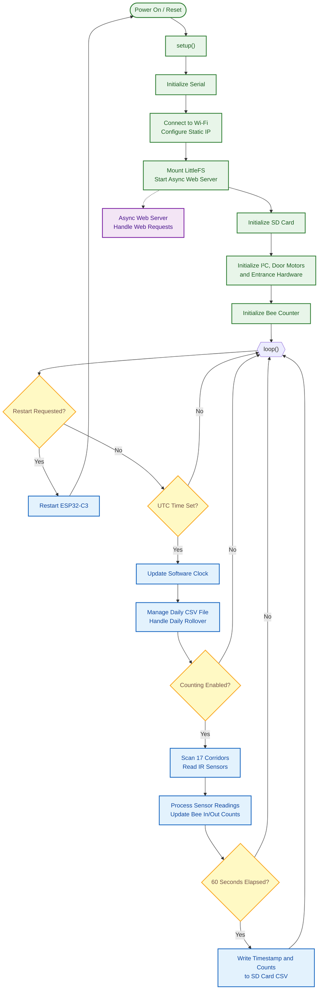

# SCIBee Entrance Counter — Firmware

## Overview

The main controller firmware runs on an ESP32-C3 and manages the SCIBee entrance counter system. It communicates with 18 ATtiny414 sensor boards over I²C, controls the entrance doors, provides a web interface via WiFi, maintains the system clock, and records bee traffic to CSV files on an SD card.

## System Architecture

The firmware consists of the following subsystems:

- **Sensor communication:** Communicates with the ATtiny414 boards over I²C to control IR LEDs and read phototransistor measurements.
- **Bee counter:** Processes three IR sensor readings per corridor and maintains individual corridor counts and total entrance and exit counts.
- **Door control:** Reads door-position sensors and controls the left and right door motors independently.
- **Web server:** Provides browser-accessible controls, configuration, system status, sensor readings, and CSV file access.
- **Time management:** Maintains a software clock based on UTC time set through the web interface.
- **Data logging:** Writes timestamped counter data to CSV files on the SD card.

## Program Flowchart

The flowchart shows the initialization sequence in `setup()` and the repeated execution of `loop()`. The asynchronous web server handles HTTP requests independently of the main loop.



### Main Execution Sequence

1. **Initialization:** `setup()` initializes Serial, connects to Wi-Fi using a static IP configuration, mounts LittleFS, starts the web server, initializes the SD card, and configures the entrance hardware and counter.
2. **Time check:** The main loop waits until UTC time has been configured through the web interface.
3. **File management:** Once time is available, the firmware updates its software clock and manages CSV files, including its configured daily rollover logic.
4. **Counting:** When counting is enabled, the controller scans the 17 corridors, processes sensor readings, and updates entrance and exit counts.
5. **Logging:** The controller writes timestamped counter data to the SD card every 60 seconds while counting is enabled.
6. **Web requests:** The asynchronous web server handles browser requests for time configuration, counter control, door movement, sensor snapshots, and CSV file access.

## Hardware Interfaces

| Interface    | Configuration   |
| ------------ | --------------- |
| I²C SDA      | GPIO 8          |
| I²C SCL      | GPIO 9          |
| I²C clock    | 400 kHz         |
| SD card CS   | GPIO 7          |
| SD card MOSI | GPIO 6          |
| SD card MISO | GPIO 5          |
| SD card SCK  | GPIO 4          |
| Right motor  | GPIO 3, GPIO 10 |
| Left motor   | GPIO 0, GPIO 1  |
| Motor PWM    | 1 kHz, 8-bit    |

The ESP32-C3 acts as the I²C master. It communicates with 18 ATtiny414 sensor boards, each assigned a unique I²C address from `40` to `57` in decimal (`0x28` to `0x39` in hexadecimal).

The complete entrance array comprises 17 corridors formed by the sensor boards and corridor structures.

## Bee Counting

Each corridor uses three IR sensing channels. The controller activates an emitter LED, reads the corresponding receiver channel, turns the LED off, and compares the sensor reading against the configured counter threshold.

The controller processes the resulting sensor patterns to track bee movements through each corridor. Individual corridor counts are accumulated into total entrance and exit counts.

The default counter threshold is `127`. It can be retrieved through `/getCounterThreshold` and updated through `/setCounterThreshold`.

The threshold is applied to the sensor readings returned by the ATtiny414 boards, which provide 8-bit values in the range `0–255`.

## Door Control

The controller reads door-position sensors and operates the left and right motors independently. Door sensor readings are compared against a configurable threshold, which defaults to `127`.

The firmware supports door movement, entrance-size adjustment, position detection, and full-opening operations. Motor operations use a timeout of `1500 ms` where configured.

The web interface provides **Load** and **Unload** controls:

- **Load:** Moves the doors toward the reference position.
- **Unload:** Runs the unloading movement in the reverse direction for approximately two seconds.

The `/setEntranceSize` endpoint accepts a requested entrance size. The web interface provides a slider with a range of 3 to 17.

## Web Interface

The asynchronous HTTP server runs on port `80`. The web interface is stored in LittleFS under `/www/`, with `index.html` as the main page.

The interface displays the controller state, current entrance size, UTC time, counter threshold, door threshold, and sensor snapshot.

It provides controls for:

- Setting the system time.
- Starting, stopping, and resetting the controller.
- Setting the entrance size.
- Loading and unloading the doors.
- Viewing sensor snapshots.
- Listing and downloading CSV files.

### API Endpoints

All listed API endpoints use HTTP GET requests.

| Endpoint               | Request parameters                                 | Description                                                                                              |
| ---------------------- | -------------------------------------------------- | -------------------------------------------------------------------------------------------------------- |
| `/setTime`             | `year`, `month`, `day`, `hour`, `minute`, `second` | Set the system date and time in UTC.                                                                     |
| `/getTime`             | None                                               | Return the current system date and time.                                                                 |
| `/getState`            | None                                               | Return the controller state.                                                                             |
| `/getEntranceSize`     | None                                               | Return the current entrance size.                                                                        |
| `/setEntranceSize`     | `size`                                             | Set the requested entrance size. The firmware also accepts `value`, `entranceSize`, and `numberOfGates`. |
| `/getCounterThreshold` | None                                               | Return the counter threshold.                                                                            |
| `/setCounterThreshold` | `threshold`                                        | Update the counter threshold.                                                                            |
| `/getDoorThreshold`    | None                                               | Return the door threshold.                                                                               |
| `/setDoorThreshold`    | `threshold`                                        | Update the door threshold.                                                                               |
| `/getSnapshot`         | None                                               | Return sensor readings for the entrance array.                                                           |
| `/start`               | None                                               | Enable counting and data logging.                                                                        |
| `/stop`                | None                                               | Disable counting and data logging.                                                                       |
| `/reset`               | None                                               | Restart the controller.                                                                                  |
| `/load`                | None                                               | Move the doors toward the reference position.                                                            |
| `/unload`              | None                                               | Run the unloading movement.                                                                              |
| `/getFileList`         | None                                               | Return the list of available CSV files.                                                                  |
| `/getFile`             | `file_name` (optional)                             | Download the current or specified CSV file.                                                              |

The `/getFile` endpoint serves the current CSV file if no filename is specified. When `file_name` is supplied, the firmware validates the requested filename, requires a `.csv` extension, and rejects path separators and `..` sequences.

The `/getFileList` endpoint is available only when the controller is stopped and the system time has been configured.

### Controller States

The `/getState` endpoint reports one of the following states:

- `waiting for time` — the system clock has not yet been configured.
- `running` — counting is enabled.
- `stopped` — counting is disabled.

Stopping the counter does not shut down the main loop or web server. The controller remains available for monitoring and configuration.

### Sensor Snapshot

The `/getSnapshot` endpoint returns sensor readings for the entrance array. The web interface displays four columns, `A`, `B`, `C`, and `D`, for each of the 17 corridors.

- Columns `A`, `B`, and `C` correspond to the three counter sensing channels.
- Column `D` corresponds to the door-position sensor reading.

The interface compares the readings against the configured counter and door thresholds and highlights the values accordingly. The snapshot can be refreshed automatically by enabling the interface's auto-update option.

### CSV File Access

The `/getFileList` endpoint returns the available CSV filenames. File listing is permitted only when the controller is stopped and the system time has been configured.

The `/getFile` endpoint accepts the optional `file_name` query parameter to select a CSV file for download.

The web interface sorts filenames by date and displays them in pages of seven files. Selecting a filename downloads the corresponding file through the browser.

## Time Configuration

The system uses **UTC (Coordinated Universal Time) exclusively**. System timestamps, date-based filenames, and logged times are based on the configured UTC clock.

The current time is set externally through the web interface or the `/setTime` endpoint. The firmware does not synchronize time automatically using NTP. Instead, it maintains a software clock using elapsed milliseconds after the time has been set.

The `/setTime` endpoint accepts the following query parameters:

- `year`
- `month`
- `day`
- `hour`
- `minute`
- `second`

The supplied web interface obtains the current UTC time from the browser and sends the date and time to the controller.**Set the UTC time after every startup, reboot, or power loss before normal counting and data logging.**

## Network Configuration

Configure the following values in the firmware before programming each entrance:

```cpp
#define BEEHIVE_ID "C1"
#define BEEHIVE_IP 101
#define BEEHIVE_SUBNET 3
#define OTA_ENABLE 0
```

The example configuration produces the following network settings:

| Setting          | Value           |
| ---------------- | --------------- |
| Controller ID    | `C1`            |
| IP address       | `192.168.3.101` |
| Gateway          | `192.168.3.1`   |
| Subnet mask      | `255.255.255.0` |
| HTTP server port | `80`            |

Assign a unique IP address and appropriate controller ID to each entrance before compiling and uploading the firmware. Ensure that the selected IP address does not conflict with another device on the network.

The Wi-Fi credentials must match the network used by the installation:

```cpp
const char *ssid = "SSID";
const char *password = "password";
```

OTA updates are disabled by default (`OTA_ENABLE 0`).

## Data Logging

The controller writes CSV data to the SD card at intervals of `60000 ms` (60 seconds) while counting is enabled.

Files use the naming format:

`C1_BEC_YYYY_MM_DD.csv`

The controller ID and date form the filename. The date is based on the configured UTC clock.

The CSV file contains the following columns:

| Column           | Description                         |
| ---------------- | ----------------------------------- |
| `Epoch_time_ms`  | Timestamp in epoch milliseconds.    |
| `In_1`–`In_17`   | Entrance counts for corridors 1–17. |
| `In_sum`         | Total entrance count.               |
| `Out_1`–`Out_17` | Exit counts for corridors 1–17.     |
| `Out_sum`        | Total exit count.                   |

The maximum configured number of CSV files is `56`.

### Daily File Rollover

The firmware performs daily CSV file rollover and resets the counters when it detects the UTC hour transition from `22` to `23`.

This timing corresponds to local midnight in Slovenia during standard time (CET, UTC+1). During daylight saving time (CEST, UTC+2), local midnight occurs at `22:00 UTC`.

## Startup and Operation

1. Configure the entrance-specific network settings before compiling and uploading the firmware.
2. Power on the controller and allow it to initialize Wi-Fi, the web server, the SD card, and the entrance hardware.
3. Open the web interface using the controller's configured IP address.
4. Set the current UTC date and time through the web interface.
5. Use **Start** to enable counting and data logging.
6. Use the web interface to monitor the controller state, entrance size, UTC time, thresholds, and sensor readings.
7. Use **Stop** before listing or downloading stored CSV files.
8. Use **Get File** to browse available CSV files and download the required file.
9. Use **Install** to access the Load and Unload door controls when required.

After a reboot or power loss, configure the UTC time again before resuming normal counting and logging.
