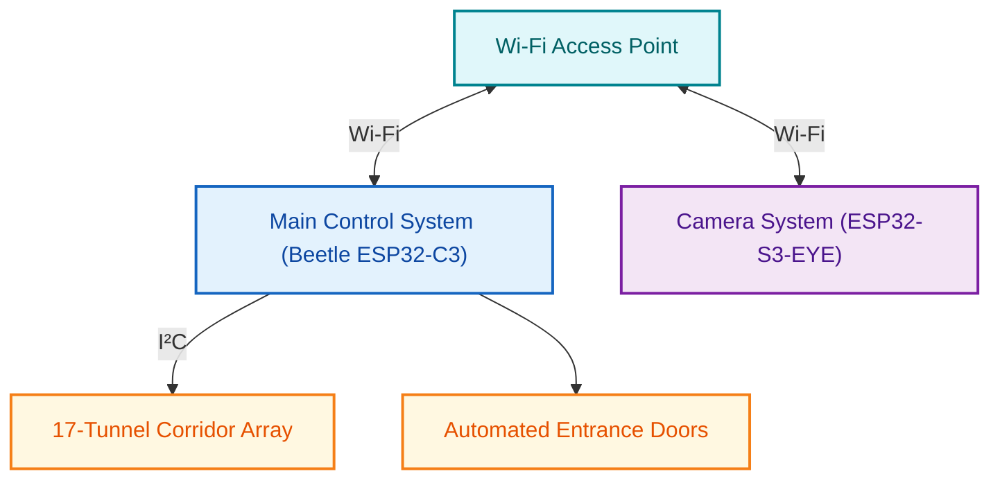
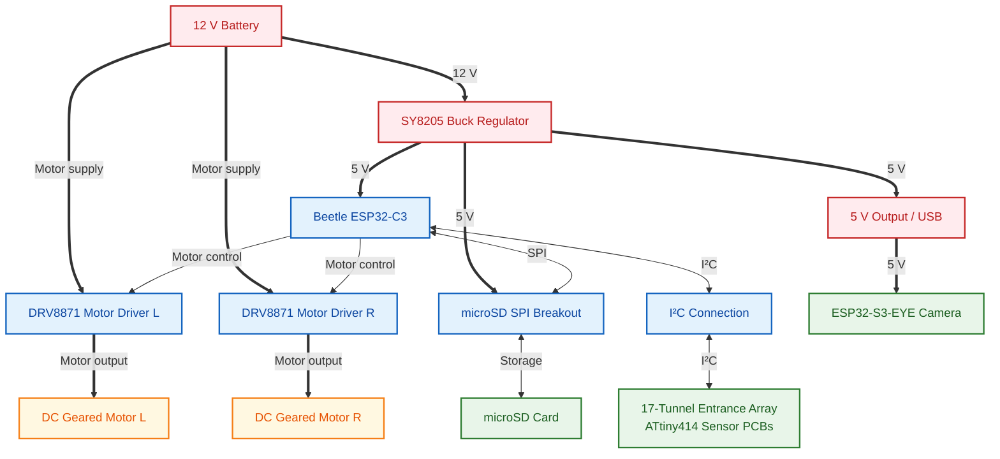

# SCIBee Entrance System

## Description

The SCIBee Entrance System monitors bee traffic at a beehive entrance, helping beekeepers assess colony activity and identify potential health issues. Seventeen entrance tunnels monitor bee movement, while a motorized mechanism adjusts the entrance opening.

A central Beetle ESP32-C3 controller collects bee movement measurements and records them in a daily CSV file with UTC timestamps. Each file is named using the UTC date.

The middle corridor is equipped with an ESP32-S3-EYE camera module. An AI model running on the ESP32-S3-EYE detects bee presence and determines when to capture images. Captured images are appended throughout the day to a TAR archive stored on a microSD card. A new archive is created each day and named using the UTC date. The images can subsequently be analyzed to identify potential parasites, particularly Varroa mites.

Both ESP32 boards host their own Wi-Fi web interfaces, providing access to monitoring data and manual control through locally hosted web pages. The interfaces also support programmatic access by other applications.

## System Overview

- **Bee movement monitoring:** Infrared sensors detect bee movement through 17 entrance tunnels.
- **Data acquisition:** ATtiny414-based corridor PCBs communicate with the ESP32-C3 controller over I²C.
- **Data logging:** Bee movement measurements are recorded every minute with UTC timestamps in daily CSV files.
- **Image capture:** The ESP32-S3-EYE runs AI inference to detect bee presence and trigger image capture in the middle corridor.
- **Image storage:** Captured images are stored in a daily TAR archive on a microSD card.
- **Connectivity:** The ESP32-C3 and ESP32-S3-EYE each provide a Wi-Fi web interface.
- **Entrance control:** Two DC geared motors actuate the adjustable entrance doors.
- **Power supply:** A 12 V lead-acid battery supplies the system. An SY8205 step-down regulator provides a 5 V supply.
- **Mechanical design:** The enclosure is 3D-printed in PETG and assembled using steel fasteners, M3 threaded inserts, and silicone components. A transparent protective foil protects the camera.
- **Design files:** The mechanical assembly is designed in FreeCAD, and the electronics are designed in KiCad.
- **Overall dimensions:** Approximately 400 × 140 × 70 mm.

## System Architecture

The diagram shows the main subsystems and their communication links.

## Electrical Overview

The diagram summarizes the power distribution, controller connections, storage interface, and motor control paths.

## Bill of Materials (BOM)

### 1. Main Structure

| Index | Name                              | Qty | 3D printed |
| ----- | --------------------------------- | ---:|:----------:|
| 1.1   | Main (printed in 2 parts)         | 1   | ✓          |
| 1.2   | Top (printed in 2 parts)          | 1   | ✓          |
| 1.3   | Bottom (Bot) (printed in 2 parts) | 1   | ✓          |
| 1.4   | Top buttons                       | 4   | ✓          |

### 2. Main Control Electronics

| Index | Name                               | Qty | 3D printed |
| ----- | ---------------------------------- | ---:|:----------:|
| 2.1   | Beetle ESP32-C3                    | 1   | ✗          |
| 2.2   | microSD SPI breakout               | 1   | ✗          |
| 2.3   | microSD card                       | 1   | ✗          |
| 2.4   | SY8205 step-down voltage regulator | 1   | ✗          |
| 2.5   | DRV8871 DC motor controller        | 2   | ✗          |
| 2.6   | Main control base foil             | 1   | ✗          |
| 2.7   | Main water wall                    | 1   | ✓          |
| 2.8   | Wire anchor                        | 1   | ✗          |

### 3. Door System

| Index | Name                        | Qty | 3D printed |
| ----- | --------------------------- | ---:|:----------:|
| 3.1   | Door (printed in 2 parts)   | 1   | ✓          |
| 3.2   | Slider (printed in 2 parts) | 1   | ✓          |
| 3.3   | PZ22GR9120R DC geared motor | 2   | ✗          |
| 3.4   | Gear 1                      | 1   | ✓          |
| 3.5   | Gear 2                      | 1   | ✓          |
| 3.6   | Motor cap 1                 | 1   | ✓          |
| 3.7   | Motor cap 2                 | 1   | ✓          |

### 4. Camera and Image Capture System

| Index | Name                               | Qty | 3D printed |
| ----- | ---------------------------------- | ---:|:----------:|
| 4.1   | ESP32-S3-EYE camera module         | 1   | ✗          |
| 4.2   | Black camera cone                  | 1   | ✓          |
| 4.3   | Bottom cap                         | 1   | ✓          |
| 4.4   | Circular LED array                 | 1   | ✗          |
| 4.5   | Bottom grille                      | 1   | ✓          |
| 4.6   | Transparent camera protective foil | 1   | ✗          |

### 5. Corridor Array

The system contains 17 assembled entrance tunnels built around 18 corridor PCBs. Each tunnel's operation is based on two sequential PCBs, with adjacent tunnels sharing a PCB.

| Index | Name                               | Qty | 3D printed |
| ----- | ---------------------------------- | ---:|:----------:|
| 5.1   | Corridor PCBs (complete boards)    | 18  | ✗          |
| 5.2   | Big side                           | 16  | ✓          |
| 5.3   | Small side                         | 16  | ✓          |
| 5.4   | Big white side                     | 1   | ✓          |
| 5.5   | Small white side                   | 1   | ✓          |
| 5.6   | Glass window                       | 1   | ✗          |
| 5.7   | SSQ-106-03-L-S corridor connectors | 18  | ✗          |

### 6. Fasteners and Inserts

| Index | Name                  | Qty |
| ----- | --------------------- | ---:|
| 6.1   | M3 × 8 screws         | 20  |
| 6.2   | M3 × 16 screws        | 2   |
| 6.3   | M3 washers            | 18  |
| 6.4   | M3 nuts               | 4   |
| 6.5   | M3 × 30 threaded rods | 11  |
| 6.6   | M3 threaded inserts   | 14  |
| 6.7   | M4 × 30 screws        | 2   |
| 6.8   | M4 washers            | 2   |
