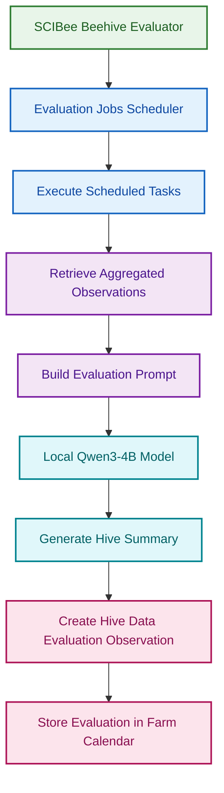

# SCIBee Beehive Evaluator

## Overview

The SCIBee Beehive Evaluator is a scheduled AI evaluation service that retrieves previously aggregated beehive observations from Farm Calendar, selects the latest valid observation for each data category, and uses a locally hosted Qwen language model to assess the current state of a honey bee colony.

The evaluator generates a concise assessment covering hive conditions, seasonal development, relevant activity, potential risks, and recommended actions. It stores the generated summary as a new **Hive data evaluation** observation in Farm Calendar, associated with the corresponding beehive parcel.

The service uses UTC-based scheduling, multiprocessing for task execution, and rotating log files for operational monitoring.

## Architecture

## Evaluation Workflow

### 1. Scheduled execution

The evaluator uses APScheduler's `BackgroundScheduler` with the UTC timezone. Jobs are triggered at specific UTC hours, and each job executes its assigned tasks using a multiprocessing pool configured for up to three worker processes.

### 2. Retrieve aggregated observations

The evaluator authenticates with Gatekeeper and retrieves previously stored Farm Calendar observations for the specified beehive.

It requests observations from the previous two days, excluding future observations, for the following categories:

| Data category             | Farm Calendar observation type    |
| ------------------------- | --------------------------------- |
| Sensor data               | `Hive sensor data aggregation`    |
| Seasonal and weather data | `Hive weather data aggregation`   |
| Community data            | `Hive community data aggregation` |

For each category, the evaluator selects the observation with the latest valid `phenomenonTime`, normalizing timestamps to UTC before comparison.

The selected observation is usable only if its `details` field exists, is non-empty, and can be parsed successfully if supplied as a JSON string. If no usable observation is found, the corresponding category is represented as `null`.

The evaluator does not collect raw sensor readings or camera images itself. It operates on aggregated data already stored in Farm Calendar.

### 3. Prepare the evaluation prompt

The selected observations are serialized into compact JSON and embedded in a prompt for the language model.

The prompt requests an approximately 150–200-word summary with exactly three sections:

- **Hive status** — overall colony conditions, seasonal stage, and relevant activity. The exact beehive name must appear in the first sentence.
- **Attention** — the most important concerns, supporting evidence, and urgency.
- **Recommended action** — prioritized, practical actions supported by the available data, or monitoring recommendations if no immediate action is indicated.

The model is instructed to consider the following information when available:

- Hive mass and significant sensor changes
- Internal temperature and humidity
- Incoming and outgoing bee traffic
- Varroa image detections
- Seasonal growing degree day (GDD) indicators
- Weather conditions and community observations

The prompt also requires the model to distinguish measured observations from estimates and potential risks, avoid unsupported conclusions, and treat missing data as inconclusive. Varroa image detections must not be interpreted as direct measurements of infestation prevalence.

Treatment recommendations must be proportionate to the evidence. In particular, formic acid treatment must not be recommended solely from a suitability score; product-label requirements and temperature restrictions take precedence.

### 4. Local AI inference

The evaluator sends the prompt to a locally hosted Qwen model using an OpenAI-compatible chat completions endpoint.

| Setting                 | Value                                       |
| ----------------------- | ------------------------------------------- |
| Model                   | `Qwen3-4B-Q4_K_M`                           |
| Endpoint                | `http://127.0.0.1:8090/v1/chat/completions` |
| Temperature             | `0.1`                                       |
| Maximum response tokens | `1000`                                      |

The generated response is extracted from the completion result and returned with the beehive name.

The local inference server must be running and accessible at the configured endpoint when an evaluation is triggered.

### 5. Store the evaluation in Farm Calendar

After generating the summary, the evaluator authenticates with Gatekeeper, resolves the beehive parcel ID, and retrieves the activity type ID for `Hive data evaluation`.

It creates a new Farm Calendar observation with the following fields:

| Field              | Description                                              |
| ------------------ | -------------------------------------------------------- |
| `activityType`     | ID of the `Hive data evaluation` activity type           |
| `title`            | Beehive name, summary label, and hash-based identifier   |
| `details`          | Object containing the beehive name and generated summary |
| `phenomenonTime`   | UTC timestamp at evaluation creation                     |
| `hasAgriParcel`    | ID of the associated beehive parcel                      |
| `hasResult`        | Result metadata with unit `1` and value `details`        |
| `observedProperty` | `beehive aggregated data`                                |

## Configuration

The evaluator loads configuration from environment variables using `python-dotenv`.

| Variable                 | Purpose                            |
| ------------------------ | ---------------------------------- |
| `ADMIN_USERNAME`         | Gatekeeper authentication username |
| `ADMIN_PASSWORD`         | Gatekeeper authentication password |
| `GATEKEEPER_BASE_URL`    | Gatekeeper API base URL            |
| `FARM_CALENDAR_BASE_URL` | Farm Calendar API base URL         |

The evaluator uses Gatekeeper for authentication and Farm Calendar for retrieving and storing observations.

## Operational Notes

- The local Qwen inference server must be available before evaluation begins.

- The evaluator depends on existing aggregated observations in Farm Calendar.

- `max_instances=1` limits concurrent instances of each scheduled job. `coalesce=False` prevents missed executions from being merged into a single run.
