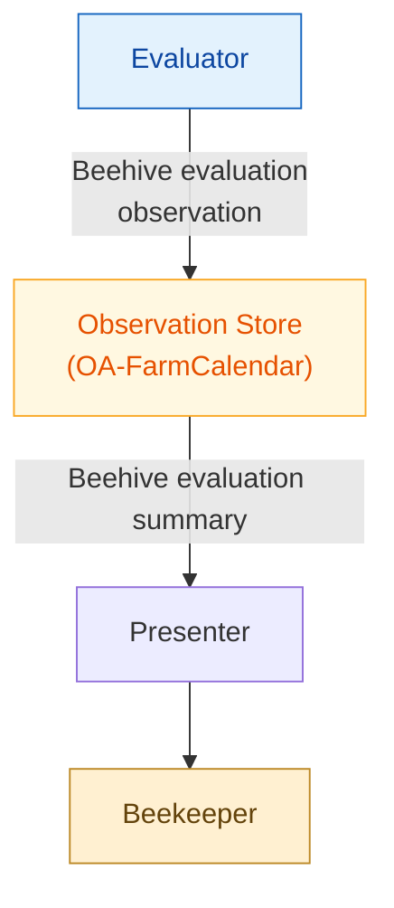

# SCIBee Presenter — Beehive Evaluation Summary

## Overview

SCIBee Presenter is a web application for displaying the latest AI-generated beehive evaluation retrieved using the OpenAgri Farm Calendar service.

The beekeeper selects a beehive by group and number. The application retrieves its latest evaluation record during the previous 14 days and displays the evaluation details and its age.

The application consists of a Python backend and a web interface built with HTML, CSS, and JavaScript.

## Main Functions

- **Beehive selection:** Selects a beehive by group (`A`–`D`) and number (`1`–`3`).
- **Latest evaluation:** Retrieves the most recent evaluation for the selected beehive.
- **Summary presentation:** Displays the beehive name, evaluation age, and evaluation details.
- **Evaluation age indicator:** Highlights evaluations that are at least 3 days old and marks those older than 7 days as critical.

## System Architecture

The Flask backend authenticates with OpenAgri Gatekeeper and retrieves observations from Farm Calendar. It filters the observations by activity type, selects the latest evaluation, and returns the relevant fields as JSON.

The web interface requests the evaluation for the selected beehive and presents the result in a readable format.



## Configuration

Configuration is loaded from environment variables defined in a `.env` file.

| Variable                 | Description                                       |
| ------------------------ | ------------------------------------------------- |
| `ADMIN_USERNAME`         | Username for OpenAgri service authentication      |
| `ADMIN_PASSWORD`         | Password for OpenAgri service authentication      |
| `GATEKEEPER_BASE_URL`    | Base URL of the Gatekeeper authentication service |
| `FARM_CALENDAR_BASE_URL` | Base URL of the Farm Calendar service             |

## HTTP API

| Endpoint   | Method | Function                                      |
| ---------- | ------ | --------------------------------------------- |
| `/`        | GET    | Serves the web interface                      |
| `/health`  | GET    | Checks application availability               |
| `/summary` | GET    | Retrieves the latest evaluation for a beehive |

### Summary Parameters

| Parameter      | Default | Description                      |
| -------------- | ------- | -------------------------------- |
| `beehive_name` | Empty   | Beehive identifier, such as `A1` |

Example:

```text
/summary?beehive_name=A1
```

The endpoint returns the beehive name, evaluation timestamp, and summary details. If no matching evaluation is found in the previous 14 days, it returns `null`.

## Notes

- The application displays existing evaluations; it does not perform the AI evaluation itself.
- Evaluation data is retrieved from the configured Farm Calendar service.
