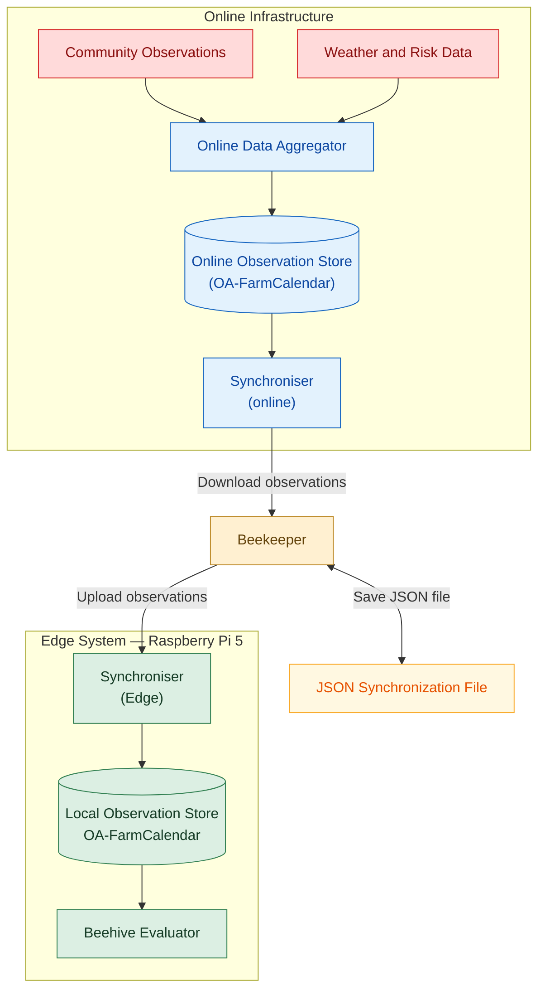

# SCIBee Synchroniser — Edge Observation Synchronization

## Overview

The SCIBee Synchroniser is a web application for transferring online observations to the local SCIBee Edge system running on a Raspberry Pi 5.

In Edge Mode, weather data, risk assessments, and community observations are collected by the online infrastructure. The beekeeper manually downloads these observations from the online server as a JSON file and uploads the file to the local Edge system.

The application consists of a Python backend using Flask and a web interface built with HTML, CSS, and JavaScript.

## Main Functions

- **Download observations:** Retrieves online observations for a specified number of days, optionally filtered by beehive group.
- **Manual data transfer:** Downloads observations as a JSON file for transfer to the local Edge system without internet connection.
- **Upload observations:** Imports previously downloaded observations into the Farm Calendar service.
- **Input validation:** Checks the JSON file format before processing observations.

## System Architecture



## Configuration

Configuration is loaded from environment variables defined in a `.env` file.

| Variable                 | Description                                       |
| ------------------------ | ------------------------------------------------- |
| `ADMIN_USERNAME`         | Username for online service authentication        |
| `ADMIN_PASSWORD`         | Password for online service authentication        |
| `GATEKEEPER_BASE_URL`    | Base URL of the Gatekeeper authentication service |
| `FARM_CALENDAR_BASE_URL` | Base URL of the Farm Calendar service             |

## Installation

### Requirements

- Python 3
- Flask
- `python-dotenv`
- The `oa_functions` module and its dependencies
- Network access to the relevant online or local Farm Calendar service during synchronization

### Install dependencies

```bash
python3 -m venv .venv
source .venv/bin/activate
pip install -r requirements.txt
```

Create a `.env` file with the required configuration variables.

## Web Interface

The web interface provides two operations:

- **Download:** Retrieves observations from the last *N* days (7 by default). Observations can be filtered by beehive group (`A` or `C`) or retrieved for all groups. The observations are downloaded as a timestamped JSON file.
- **Upload via Wi-Fi:** Accepts a previously downloaded JSON file, checks that it contains an array of observations, and submits the records to the configured Farm Calendar service.

## HTTP API

| Endpoint    | Method | Function                                                   |
| ----------- | ------ | ---------------------------------------------------------- |
| `/`         | GET    | Serves the web interface                                   |
| `/health`   | GET    | Checks application availability                            |
| `/download` | GET    | Retrieves and downloads observations as JSON               |
| `/upload`   | POST   | Uploads observations from a JSON file or JSON request body |

### Download Parameters

| Parameter      | Default | Description                                                       |
| -------------- | ------- | ----------------------------------------------------------------- |
| `days`         | `7`     | Number of days of observations to retrieve; must be at least `1`  |
| `beehive_name` | Empty   | Optional beehive group filter; an empty value requests all groups |

Example:

```text
/download?days=7&beehive_name=A
```

## Notes

- Synchronization is **manual**; the application does not automatically transfer files between the online server and the Edge system.
- Online connectivity is required for download. 
- Connection to the local Edge local Wi-Fi network is required for upload.
- Synchronization can also be used in reverse direction.
